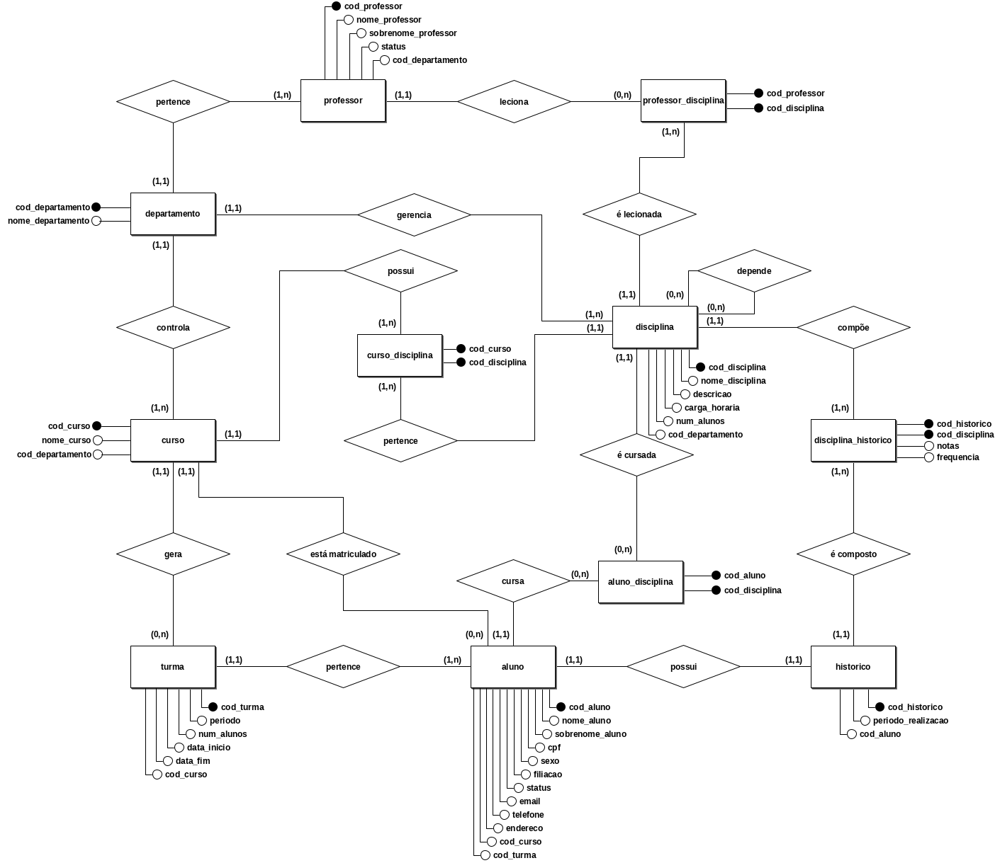

# Projeto de Banco de Dados - Sistema de Gestão Acadêmica
Este projeto prático foi desenvolvido como parte dos estudos de modelagem de dados do canal Bóson Treinamentos no Youtube. O objetivo principal é projetar, modelar, implementar, analisar e documentar um banco de dados relacional completo para o gerenciamento básico de uma instituição de ensino.

Não se trata de uma cópia idêntica do curso, mas de uma expansão: introduzi ajustes próprios em estruturas, nomenclaturas e regras para consolidar e aprofundar o aprendizado.

Por fim, este repositório foi criado para servir tanto como peça de portfólio quanto como um guia passo a passo para iniciantes que desejam entender como um banco de dados nasce a partir de regras de negócios.

O curso completo pode ser acessado na [Playlist do Bóson Treinamentos no YouTube](https://youtube.com/playlist?list=PLucm8g_ezqNoNHU8tjVeHmRGBFnjDIlxD&si=rU52ZSrKq_UzlwF_).

Ferramentas utilizadas:
- brModelo: Criação dos modelos conceitual e lógico.
- PostgreSQL: Sistema Gerenciador de Banco de Dados Relacional (SGBDR) utilizado na implementação.
- DBeaver/pgAdmin 4: Interface gráfica para manipulação e gerenciamento do banco.

# Capítulo 1: Levantamento de requisitos e regras de negócio

Antes de desenhar qualquer tabela, precisamos entender o funcionamento da instituição de ensino. Abaixo estão listadas as regras de negócio que moldam a nossa estrutura de dados:

Alunos e Matrículas:
- Um aluno só pode estar matriculado em um curso por vez.
- Alunos possuem um código de identificação único e são identificados também por CPF.
- Alunos podem trancar a matrícula, nesse estado, ficam sem disciplinas associadas no semestre.
- Em cada semestre, cada aluno pode se matricular em no máximo 9 disciplinas.
- O aluno pode ser reprovado no máximo 3 vezes na mesma disciplina.
- A faculdade comporta no máximo 3.000 alunos matriculados simultaneamente em 10 cursos distintos, com uma entrada de 300 alunos novos por ano.

Cursos e Disciplinas:
- Os cursos são compostos por disciplinas que pertencem a departamentos específicos.
- Existem 90 disciplinas no total disponíveis na instituição.
- Cada disciplina tem um código de identificação e suporta no máximo 30 alunos por turma.
- As disciplinas podem ser obrigatórias ou optativas, dependendo do curso.
- Uma disciplina pode ter dependências de outras disciplinas (pré-requisitos).
- O histórico escolar registra todas as disciplinas cursadas pelo aluno, incluindo nota final, frequência e período de realização.

Professores e Departamentos:
- Existem 40 professores trabalhando na instituição, vinculados a departamentos específicos.
- Professores podem ser cadastrados mesmo sem lecionar disciplinas no momento.
- Cada professor pode lecionar no máximo 4 disciplinas diferentes.
- Professores são identificados por um código de professor.

# Capítulo 2: Identificação de entidades, relacionamentos e atributos

Nesta etapa, traduzimos as regras de negócio do Capítulo 1 em elementos de dados estruturados. Inicialmente, focamos em mapear as entidades, seus relacionamentos conceituais e seus atributos de forma direta, sem aplicar regras de normalização e sem criar as tabelas associativas neste momento.

## 2.1 Entidades identificadas

Com base no escopo da faculdade, identificamos as seguintes entidades:

- departamento: Setores acadêmicos que gerenciam cursos, disciplinas e professores.
- curso: Cursos superiores oferecidos pela faculdade.
- disciplina: Matérias que compõem os cursos.
- professor: Corpo docente da instituição.
- turma: Instâncias de oferta de disciplinas/períodos.
- aluno: Alunos matriculados na faculdade.
- historico: Registro acadêmico consolidado do aluno.

## 2.2 Relacionamentos iniciais:

Nesta etapa conceitual, mapeamos como as entidades se relacionam entre si.

- Aluno está matriculado em curso
- Aluno cursa disciplina
- Aluno realizou disciplina
- Disciplina pertence a curso
- Professor ministra disciplina
- Professor pertence a departamento
- Departamento é responsável por disciplina
- Departamento controla curso
- Disciplina depende de disciplina

## 2.3 Atributos por entidade

Abaixo estão listados os atributos identificados para cada entidade.

departamento:
- cod_departamento (PK)
- nome_departamento

curso:
- cod_curso (PK)
- nome_curso
- cod_departamento (FK)

disciplina:
- cod_disciplina (PK)
- nome_disciplina
- descricao
- carga_horaria
- num_alunos
- cod_departamento (FK)

professor:
- cod_professor (PK)
- nome_professor
- sobrenome_professor
- status
- cod_departamento (FK)

turma:
- cod_turma (PK)
- periodo
- num_alunos
- data_inicio
- data_fim
- cod_curso (FK)

aluno:
- cod_aluno (PK)
- nome_aluno
- sobrenome_aluno
- cpf
- sexo
- filiacao
- status
- email
- telefone
- endereco
- cod_curso (FK)
- cod_turma (FK)

historico:
- cod_historico (PK)
- notas
- frequencia
- periodo_realizacao
- cod_aluno (FK)
- cod_disciplina (FK)

# Capítulo 3: Modelagem conceitual

Após identificação inicial das entidades, relacionamentos e atributos no Capítulo 2, apresentamos o desenvolvimento do modelo conceitual utilizando o software brModelo. Nesta etapa, definimos as cardinalidades (mínima e máxima) de cada relacionamento e preparamos o terreno para a modelagem lógica.

## 3.1 Relacionamentos

Abaixo, detalhamos como as entidades se relacionam. Para cada relacionamento, respondemos às perguntas fundamentais de cardinalidade e apresentamos a imagem do modelo conceitual no brModelo.

**Relacionamento entre as entidades professor e departamento:**
- Pergunta: Cada professor pertence a quantos departamentos?
- Resposta: Cada professor obrigatoriamente pertence a 1 (e apenas 1) departamento, logo, a cardinalidade é (1,1).
- Pergunta: Cada departamento possui quantos professores?
- Resposta: Cada departamento pode possuir de 1 até n professores, logo, a cardinalidade é (1,n).

**Relacionamento entre as entidades departamento e disciplina:**
- Pergunta: Cada departamento gerencia quantas disciplinas?
- Resposta: Cada departamento gerencia no mínimo 1 e no máximo n disciplinas, logo, a cardinalidade é (1,n).
- Pergunta: Cada disciplina é gerenciada por quantos departamentos?
- Resposta: Cada disciplina é gerenciada por 1 (e apenas 1) departamento, logo, a cardinalidade é (1,1).

**Relacionamento entre as entidades departamento e curso:**
- Pergunta: Cada departamento controla quantos cursos?
- Resposta: Cada departamento controla no mínimo 1 e no máximo n cursos, logo, a cardinalidade é (1,n).
- Pergunta: Cada curso é controlado por quantos departamentos?
- Resposta: Cada curso é controlado por 1 (e apenas 1) departamento, logo, a cardinalidade é (1,1).

**Relacionamento entre as entidades aluno e curso:**
- Pergunta: Cada aluno está matriculado em quantos cursos?
- Resposta: Cada aluno só pode se matricular em 1 curso por vez (conforme as regras de negócio), logo, a cardinalidade é (1,1).
- Pergunta: Cada curso possui matriculado quantos alunos?
- Resposta: Cada curso pode possuir matriculado no mínimo 0 e no máximo n alunos, logo, a cardinalidade é (0,n).

**Relacionamento entre as entidades curso e turma:**
- Pergunta: Cada curso gera quantas turmas?
- Resposta: Cada curso pode gerar no mínimo 0 turmas e no máximo n turmas, logo, a cardinalidade é (0,n).
- Pergunta: Cada turma pode ser gerada por quantos cursos?
- Resposta: Cada turma pode ser gerada por 1 (e apenas 1) curso, logo, a cardinalidade é (1,1).

**Relacionamento entre as entidades aluno e turma:**
- Pergunta: Cada aluno pertence a quantas turmas?
- Resposta: Cada aluno pertence a 1 (e apenas 1) turma, logo, a cardinalidade é (1,1).
- Pergunta: Cada turma pode ser formada por quantos alunos?
- Resposta: Cada turma pode ser formada por no mínimo 1 e no máximo n alunos, logo, a cardinalidade é (1,n).

**Relacionamento entre as entidades aluno e histórico:**
- Pergunta: Cada aluno possui quantos históricos?
- Resposta: Cada aluno possui 1 (e apenas 1) histórico, logo a cardinalidade é (1,1).
- Pergunta: Cada histórico pertence a quantos alunos?
- Resposta: Cada histórico pertence a 1 (e apenas 1) aluno, logo, a cardinalidade é (1,1).
- 

**Relacionamento entre as entidades disciplina e disciplina (auto-relacionamento):**
- Pergunta: Cada disciplina depende (possui como pré-requisito) de quantas disciplinas?
- Resposta: Cada disciplina pode depender de no mínimo 0 e no máximo n disciplinas, logo, a cardinalidade é (0,n).

## 3.2 Relacionamentos muitos para muitos

Sempre que duas entidades se relacionam de forma que um registro de um lado se liga a vários do outro (e vice-versa), o modelo relacional não permite mapear isso diretamente com uma simples chave estrangeira. Para resolver isso, utilizamos uma entidade associativa (tabela intermediária) para quebrar essa cardinalidade em dois relacionamentos.

Abaixo, detalhamos os casos de relacionamentos muitos para muitos, respondemos às perguntas fundamentais de cardinalidade e apresentamos a solução adotada.

### 3.2.1 Relacionamento entre as entidades professor e disciplina

- Pergunta: Cada professor leciona quantas disciplinas?
- Resposta: Cada professor pode lecionar no mínimo 0 (um professor pode ser cadastrado mesmo sem lecionar disciplinas, ou pode se afastar temporariamente) e no máximo n disciplinas, logo, a cardinalidade é (0,n).
- Pergunta: Cada disciplina é lecionada por quantos professores?
- Resposta: Cada disciplina pode ser lecionada por no mínimo 1 no máximo n professores, logo, a cardinalidade é (1,n).

Como um professor pode lecionar várias disciplinas, e uma disciplina pode ser lecionada por vários professores, temos um relacionamento de muitos para muitos.

Para solucionar isso, criamos uma nova entidade associativa denominada professor_disciplina, cujos relacionamentos resultantes passam a ser:

**Relacionamento entre as entidades professor e professor_disciplina:**
- Pergunta: Cada professor está associado a quantas instâncias em professor_disciplina?
- Resposta: Cada professor está associado a no mínimo 0 e no máximo n instâncias em professor_disciplina, logo, a cardinalidade é (0,n).
- Pergunta: Cada instância em professor_disciplina refere-se a quantos professores?
- Resposta: Cada instância refere-se obrigatoriamente a 1 (e apenas 1) professor, logo, a cardinalidade é (1,1).

**Relacionamento entre as entidades disciplina e professor_disciplina:**
- Pergunta: Cada disciplina está associada a quantas instâncias em professor_disciplina?
- Resposta: Cada disciplina está associada a no mínimo 1 e no máximo n instâncias em professor_disciplina, logo, a cardinalidade é (1,n).
- Pergunta: Cada instância em professor_disciplina refere-se a quantas disciplinas?
- Resposta: Cada instância refere-se obrigatoriamente a 1 (e apenas 1) disciplina, logo, a cardinalidade é (1,1).

### 3.2.2 Relacionamento entre as entidades aluno e disciplina

- Pergunta: Cada aluno cursa quantas disciplinas?
- Resposta: Cada aluno pode cursar no mínimo 0 e no máximo n disciplinas, logo, a cardinalidade é (0,n).
- Pergunta: Cada disciplina é cursada por quantos alunos?
- Resposta: Cada disciplina pode ser cursada por no mínimo 0 e no máximo n alunos, logo, a cardinalidade é (0,n).

Como um aluno pode cursar várias disciplinas, e uma disciplina pode ser cursada por vários alunos, temos um relacionamento de muitos para muitos.

Para solucionar isso, criamos uma nova entidade associativa denominada aluno_disciplina, cujos relacionamentos resultantes passam a ser:

**Relacionamento entre as entidades aluno e aluno_disciplina:**
- Pergunta: Cada aluno está associado a quantas instâncias em aluno_disciplina?
- Resposta: Cada aluno está associado a no mínimo 0 e no máximo n instâncias em aluno_disciplina, logo, a cardinalidade é (0,n).
- Pergunta: Cada instância em aluno_disciplina refere-se a quantos alunos?
- Resposta: Cada instância refere-se obrigatoriamente a 1 (e apenas 1) aluno, logo, a cardinalidade é (1,1).

**Relacionamento entre as entidades disciplina e aluno_disciplina:**
- Pergunta: Cada disciplina está associada a quantas instâncias em aluno_disciplina?
- Resposta: Cada disciplina está associada a no mínimo 0 e no máximo n instâncias em aluno_disciplina, logo, a cardinalidade é (0,n).
- Pergunta: Cada instância em aluno_disciplina refere-se a quantas disciplinas?
- Resposta: Cada instância refere-se obrigatoriamente a 1 (e apenas 1) disciplina, logo, a cardinalidade é (1,1).

### 3.2.3 Relacionamento entre as entidades curso e disciplina

- Pergunta: Cada curso possui quantas disciplinas?
- Resposta: Cada curso possui no mínimo 1 e no máximo n disciplinas, logo, a cardinalidade é (1,n).
- Pergunta: Cada disciplina pertence a quantos cursos?
- Resposta: Cada disciplina pertence a no mínimo 1 e no máximo n cursos, logo, a cardinalidade é (1,n).

Como um curso pode possuir várias disciplinas, e uma disciplina pode pertencer a vários cursos, temos um relacionamento de muitos para muitos.

Para solucionar isso, criamos uma nova entidade associativa denominada curso_disciplina, cujos relacionamentos resultantes passam a ser:

**Relacionamento entre as entidades curso e curso_disciplina:**
- Pergunta: Cada curso está associado a quantas instâncias em curso_disciplina?
- Resposta: Cada curso está associado a no mínimo 1 e no máximo n instâncias em curso_disciplina, logo, a cardinalidade é (1,n).
- Pergunta: Cada instância em curso_disciplina refere-se a quantos cursos?
- Resposta: Cada instância refere-se obrigatoriamente a 1 (e apenas 1) curso, logo, a cardinalidade é (1,1).

**Relacionamento entre as entidades disciplina e curso_disciplina:**
- Pergunta: Cada disciplina está associada a quantas instâncias em curso_disciplina?
- Resposta: Cada disciplina está associada a no mínimo 1 e no máximo n instâncias em curso_disciplina, logo, a cardinalidade é (1,n).
- Pergunta: Cada instância em curso_disciplina refere-se a quantas disciplinas?
- Resposta: Cada instância refere-se obrigatoriamente a 1 (e apenas 1) disciplina, logo, a cardinalidade é (1,1).

### 3.2.4 Relacionamento entre as entidades disciplina e histórico

- Pergunta: Cada disciplina compõe quantos históricos?
- Resposta: Cada disciplina pode compor no mínimo 1 e no máximo n históricos, logo, a cardinalidade é (1,n).
- Pergunta: Cada histórico é composto por quantas disciplinas?
- Resposta: Cada histórico pode ser composto por no mínimo 1 e no máximo n disciplinas, logo, a cardinalidade é (1,n).

Como uma disciplina pode compor vários históricos, e um histórico pode ser composto de várias disciplinas, temos um relacionamento de muitos para muitos.

Para solucionar isso, criamos uma nova entidade associativa denominada disciplina_historico, cujos relacionamentos resultantes passam a ser:

**Relacionamento entre as entidades disciplina e disciplina_historico:**
- Pergunta: Cada disciplina está associada a quantas instâncias em disciplina_historico?
- Resposta: Cada disciplina está associada a no mínimo 1 e no máximo n instâncias em disciplina_historico, logo, a cardinalidade é (1,n).
- Pergunta: Cada instância em disciplina_historico refere-se a quantas disciplinas?
- Resposta: Cada instância refere-se obrigatoriamente a 1 (e apenas 1) disciplina, logo, a cardinalidade é (1,1).

**Relacionamento entre as entidades historico e disciplina_historico:**
- Pergunta: Cada histórico está associado a quantas instâncias em disciplina_historico?
- Resposta: Cada histórico está associado a no mínimo 1 e no máximo n instâncias em disciplina_historico, logo, a cardinalidade é (1,n).
- Pergunta: Cada instância em disciplina_historico refere-se a quantos históricos?
- Resposta: Cada instância refere-se obrigatoriamente a 1 (e apenas 1) histórico, logo, a cardinalidade é (1,1).

## 3.3 Ajustes estruturais

Com a introdução das entidades associativas para resolver os relacionamentos muitos para muitos, foi necessário reorganizar alguns atributos levantados inicialmente no Capítulo 2. Além disso, foi necessário adicionar os atributos dessas entidades associativas.

disciplina_historico (entidade associativa):
- cod_historico (PK/FK)
- cod_disciplina (PK/FK)
- notas (movido de historico, pois a nota pertence à relação entre a disciplina e o histórico)
- frequencia (movido de historico, pois a frequência pertence à relação entre a disciplina e o histórico)

aluno_disciplina (entidade associativa):
- cod_aluno (PK/FK)
- cod_disciplina (PK/FK)

curso_disciplina (entidade associativa):
- cod_curso (PK/FK)
- cod_disciplina (PK/FK)

professor_disciplina (entidade associativa):
- cod_professor (PK/FK)
- cod_disciplina (PK/FK)

## 3.4 Modelo conceitual

Abaixo apresentamos o diagrama conceitual completo no brModelo.

