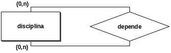
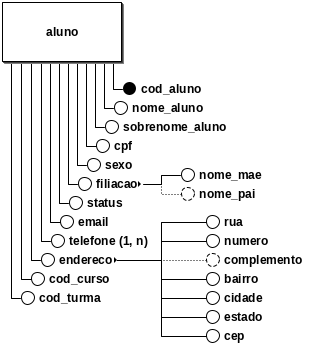
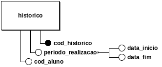
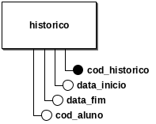
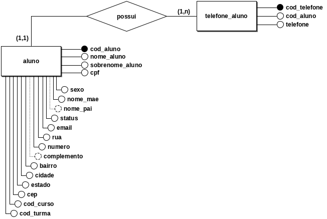
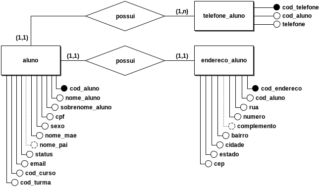
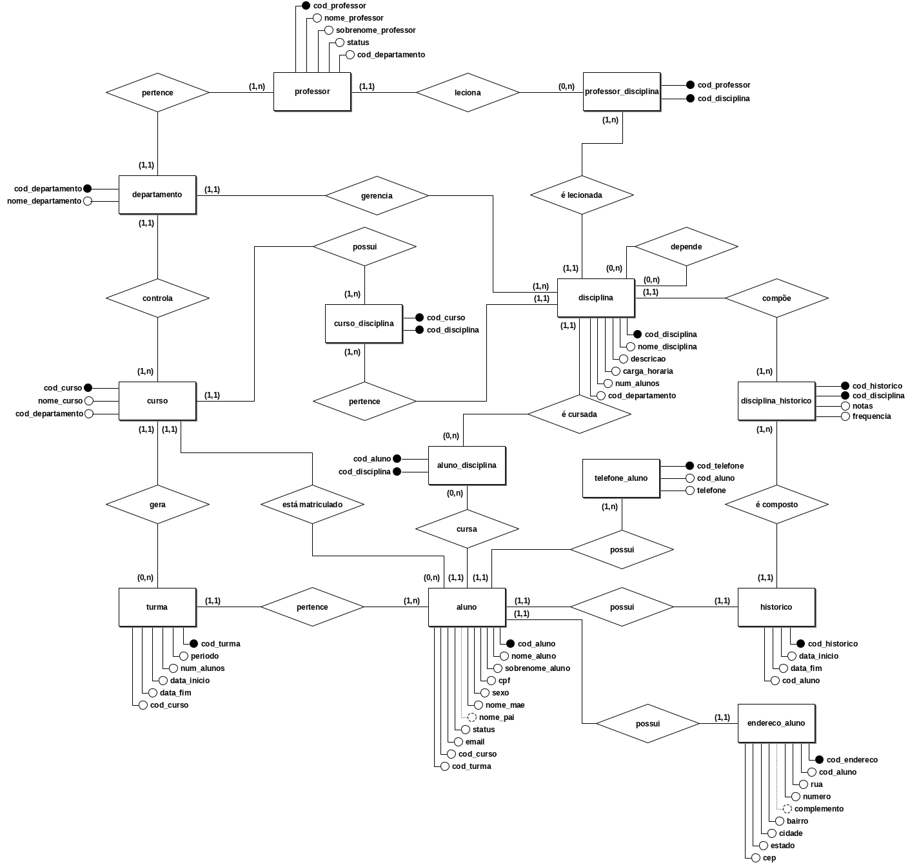
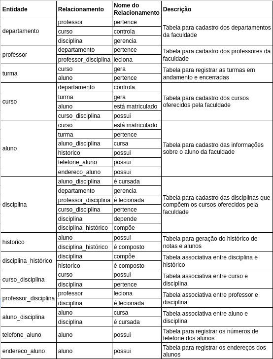
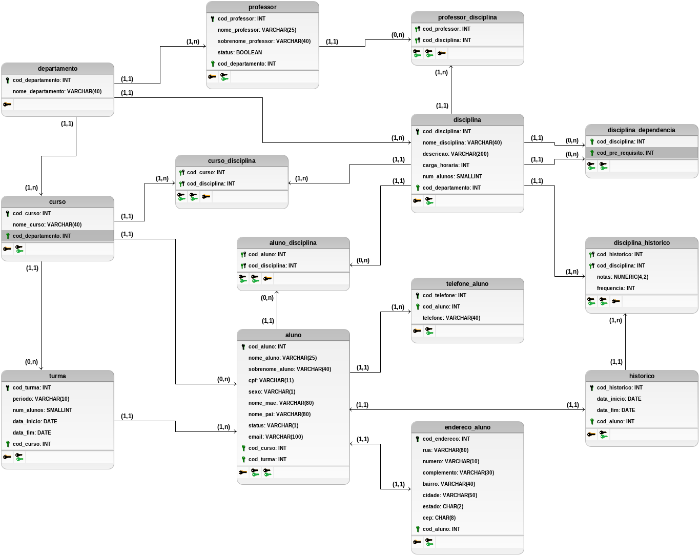

# Projeto de Banco de Dados - Sistema de Gestão Acadêmica
**Autor: Victor A.M. Nossal**

Este projeto prático foi desenvolvido como parte dos estudos de modelagem de dados do canal Bóson Treinamentos no Youtube. O objetivo principal é projetar, modelar, implementar, analisar e documentar um banco de dados relacional completo para o gerenciamento básico de uma instituição de ensino.

Não se trata de uma cópia idêntica do curso, mas de uma expansão: introduzi ajustes próprios em estruturas, nomenclaturas e regras para consolidar e aprofundar o aprendizado.

Por fim, este repositório foi criado para servir tanto como peça de portfólio quanto como um guia passo a passo para iniciantes que desejam entender como um banco de dados nasce a partir de regras de negócios.

O curso completo pode ser acessado na [Playlist do Bóson Treinamentos no YouTube](https://youtube.com/playlist?list=PLucm8g_ezqNoNHU8tjVeHmRGBFnjDIlxD&si=rU52ZSrKq_UzlwF_).

Ferramentas utilizadas:
- brModelo: Criação dos modelos conceitual e lógico.
- PostgreSQL: Sistema Gerenciador de Banco de Dados Relacional (SGBDR) utilizado na implementação.
- DBeaver/pgAdmin 4: Interface gráfica para manipulação e gerenciamento do banco.

---
## Sumário
* [Capítulo 1: Levantamento de requisitos e regras de negócio](#capítulo-1-levantamento-de-requisitos-e-regras-de-negócio)
* [Capítulo 2: Identificação de entidades, relacionamentos e atributos](#capítulo-2-identificação-de-entidades-relacionamentos-e-atributos)
* [Capítulo 3: Modelagem conceitual](#capítulo-3-modelagem-conceitual)
* [Capítulo 4: Normalização](#capítulo-4-normalização)
* [Capítulo 5: Dicionário de dados](#capítulo-5-dicionário-de-dados)
* [Capítulo 6: Modelagem lógica](#capítulo-6-modelagem-lógica)
* [Capítulo 7: Implementação do banco de dados](#capítulo-7-implementação-do-banco-de-dados)
* [Capítulo 8: Consultas no banco de dados](#capítulo-8-consultas-no-banco-de-dados)
* [Capítulo 9: Conclusão](#capítulo-9-conclusão)
---


# Capítulo 1: Levantamento de requisitos e regras de negócio

Antes de desenhar qualquer tabela, precisamos entender o funcionamento da instituição de ensino. Abaixo estão listadas as regras de negócio que moldam a nossa estrutura de dados:

Alunos e Matrículas:
- Um aluno só pode estar matriculado em um curso por vez.
- Alunos possuem um código de identificação único e são identificados também por CPF.
- Alunos podem trancar a matrícula, nesse estado, ficam sem disciplinas associadas no semestre.
- Em cada semestre, cada aluno pode se matricular em no máximo 9 disciplinas.
- O aluno pode ser reprovado no máximo 3 vezes na mesma disciplina.
- A faculdade comporta no máximo 3.000 alunos matriculados simultaneamente em 10 cursos distintos, com uma entrada de 300 alunos novos por ano.

Cursos e Disciplinas:
- Os cursos são compostos por disciplinas que pertencem a departamentos específicos.
- Existem 90 disciplinas no total disponíveis na instituição.
- Cada disciplina tem um código de identificação e suporta no máximo 30 alunos por turma.
- As disciplinas podem ser obrigatórias ou optativas, dependendo do curso.
- Uma disciplina pode ter dependências de outras disciplinas (pré-requisitos).
- O histórico escolar registra todas as disciplinas cursadas pelo aluno, incluindo nota final, frequência e período de realização.

Professores e Departamentos:
- Existem 40 professores trabalhando na instituição, vinculados a departamentos específicos.
- Professores podem ser cadastrados mesmo sem lecionar disciplinas no momento.
- Cada professor pode lecionar no máximo 4 disciplinas diferentes.
- Professores são identificados por um código de professor.


# Capítulo 2: Identificação de entidades, relacionamentos e atributos

Nesta etapa, traduzimos as regras de negócio do Capítulo 1 em elementos de dados estruturados. Inicialmente, focamos em mapear as entidades, seus relacionamentos conceituais e seus atributos de forma direta, sem aplicar regras de normalização e sem criar as tabelas associativas neste momento.

## 2.1 Entidades identificadas

Com base no escopo da faculdade, identificamos as seguintes entidades:

- departamento: Setores acadêmicos que gerenciam cursos, disciplinas e professores.
- curso: Cursos superiores oferecidos pela faculdade.
- disciplina: Matérias que compõem os cursos.
- professor: Corpo docente da instituição.
- turma: Instâncias de oferta de disciplinas/períodos.
- aluno: Alunos matriculados na faculdade.
- historico: Registro acadêmico consolidado do aluno.

## 2.2 Relacionamentos iniciais:

Nesta etapa conceitual, mapeamos como as entidades se relacionam entre si.

- Aluno está matriculado em curso
- Aluno cursa disciplina
- Aluno realizou disciplina
- Disciplina pertence a curso
- Professor ministra disciplina
- Professor pertence a departamento
- Departamento é responsável por disciplina
- Departamento controla curso
- Disciplina depende de disciplina

## 2.3 Atributos por entidade

Abaixo estão listados os atributos identificados para cada entidade.

departamento:
- cod_departamento (PK)
- nome_departamento

curso:
- cod_curso (PK)
- nome_curso
- cod_departamento (FK)

disciplina:
- cod_disciplina (PK)
- nome_disciplina
- descricao
- carga_horaria
- num_alunos
- cod_departamento (FK)

professor:
- cod_professor (PK)
- nome_professor
- sobrenome_professor
- status
- cod_departamento (FK)

turma:
- cod_turma (PK)
- periodo
- num_alunos
- data_inicio
- data_fim
- cod_curso (FK)

aluno:
- cod_aluno (PK)
- nome_aluno
- sobrenome_aluno
- cpf
- sexo
- filiacao
- status
- email
- telefone
- endereco
- cod_curso (FK)
- cod_turma (FK)

historico:
- cod_historico (PK)
- notas
- frequencia
- periodo_realizacao
- cod_aluno (FK)
- cod_disciplina (FK)


# Capítulo 3: Modelagem conceitual

Após identificação inicial das entidades, relacionamentos e atributos no Capítulo 2, apresentamos o desenvolvimento do modelo conceitual utilizando o software brModelo. Nesta etapa, definimos as cardinalidades (mínima e máxima) de cada relacionamento e preparamos o terreno para a modelagem lógica.

## 3.1 Relacionamentos

Abaixo, detalhamos como as entidades se relacionam. Para cada relacionamento, respondemos às perguntas fundamentais de cardinalidade e apresentamos a imagem do modelo conceitual no brModelo.

**Relacionamento entre as entidades professor e departamento:**
- Pergunta: Cada professor pertence a quantos departamentos?
- Resposta: Cada professor obrigatoriamente pertence a 1 (e apenas 1) departamento, logo, a cardinalidade é (1,1).
- Pergunta: Cada departamento possui quantos professores?
- Resposta: Cada departamento pode possuir de 1 até n professores, logo, a cardinalidade é (1,n).


**Relacionamento entre as entidades departamento e disciplina:**
- Pergunta: Cada departamento gerencia quantas disciplinas?
- Resposta: Cada departamento gerencia no mínimo 1 e no máximo n disciplinas, logo, a cardinalidade é (1,n).
- Pergunta: Cada disciplina é gerenciada por quantos departamentos?
- Resposta: Cada disciplina é gerenciada por 1 (e apenas 1) departamento, logo, a cardinalidade é (1,1).


**Relacionamento entre as entidades departamento e curso:**
- Pergunta: Cada departamento controla quantos cursos?
- Resposta: Cada departamento controla no mínimo 1 e no máximo n cursos, logo, a cardinalidade é (1,n).
- Pergunta: Cada curso é controlado por quantos departamentos?
- Resposta: Cada curso é controlado por 1 (e apenas 1) departamento, logo, a cardinalidade é (1,1).


**Relacionamento entre as entidades aluno e curso:**
- Pergunta: Cada aluno está matriculado em quantos cursos?
- Resposta: Cada aluno só pode se matricular em 1 curso por vez (conforme as regras de negócio), logo, a cardinalidade é (1,1).
- Pergunta: Cada curso possui matriculado quantos alunos?
- Resposta: Cada curso pode possuir matriculado no mínimo 0 e no máximo n alunos, logo, a cardinalidade é (0,n).


**Relacionamento entre as entidades curso e turma:**
- Pergunta: Cada curso gera quantas turmas?
- Resposta: Cada curso pode gerar no mínimo 0 turmas e no máximo n turmas, logo, a cardinalidade é (0,n).
- Pergunta: Cada turma pode ser gerada por quantos cursos?
- Resposta: Cada turma pode ser gerada por 1 (e apenas 1) curso, logo, a cardinalidade é (1,1).


**Relacionamento entre as entidades aluno e turma:**
- Pergunta: Cada aluno pertence a quantas turmas?
- Resposta: Cada aluno pertence a 1 (e apenas 1) turma, logo, a cardinalidade é (1,1).
- Pergunta: Cada turma pode ser formada por quantos alunos?
- Resposta: Cada turma pode ser formada por no mínimo 1 e no máximo n alunos, logo, a cardinalidade é (1,n).


**Relacionamento entre as entidades aluno e histórico:**
- Pergunta: Cada aluno possui quantos históricos?
- Resposta: Cada aluno possui 1 (e apenas 1) histórico, logo a cardinalidade é (1,1).
- Pergunta: Cada histórico pertence a quantos alunos?
- Resposta: Cada histórico pertence a 1 (e apenas 1) aluno, logo, a cardinalidade é (1,1).
- 


**Relacionamento entre as entidades disciplina e disciplina (auto-relacionamento):**
- Pergunta: Cada disciplina depende (possui como pré-requisito) de quantas disciplinas?
- Resposta: Cada disciplina pode depender de no mínimo 0 e no máximo n disciplinas, logo, a cardinalidade é (0,n).



## 3.2 Relacionamentos muitos para muitos

Sempre que duas entidades se relacionam de forma que um registro de um lado se liga a vários do outro (e vice-versa), o modelo relacional não permite mapear isso diretamente com uma simples chave estrangeira. Para resolver isso, utilizamos uma entidade associativa (tabela intermediária) para quebrar essa cardinalidade em dois relacionamentos.

Abaixo, detalhamos os casos de relacionamentos muitos para muitos, respondemos às perguntas fundamentais de cardinalidade e apresentamos a solução adotada.

### 3.2.1 Relacionamento entre as entidades professor e disciplina

- Pergunta: Cada professor leciona quantas disciplinas?
- Resposta: Cada professor pode lecionar no mínimo 0 (um professor pode ser cadastrado mesmo sem lecionar disciplinas, ou pode se afastar temporariamente) e no máximo n disciplinas, logo, a cardinalidade é (0,n).
- Pergunta: Cada disciplina é lecionada por quantos professores?
- Resposta: Cada disciplina pode ser lecionada por no mínimo 1 no máximo n professores, logo, a cardinalidade é (1,n).


Como um professor pode lecionar várias disciplinas, e uma disciplina pode ser lecionada por vários professores, temos um relacionamento de muitos para muitos.

Para solucionar isso, criamos uma nova entidade associativa denominada professor_disciplina, cujos relacionamentos resultantes passam a ser:

**Relacionamento entre as entidades professor e professor_disciplina:**
- Pergunta: Cada professor está associado a quantas instâncias em professor_disciplina?
- Resposta: Cada professor está associado a no mínimo 0 e no máximo n instâncias em professor_disciplina, logo, a cardinalidade é (0,n).
- Pergunta: Cada instância em professor_disciplina refere-se a quantos professores?
- Resposta: Cada instância refere-se obrigatoriamente a 1 (e apenas 1) professor, logo, a cardinalidade é (1,1).


**Relacionamento entre as entidades disciplina e professor_disciplina:**
- Pergunta: Cada disciplina está associada a quantas instâncias em professor_disciplina?
- Resposta: Cada disciplina está associada a no mínimo 1 e no máximo n instâncias em professor_disciplina, logo, a cardinalidade é (1,n).
- Pergunta: Cada instância em professor_disciplina refere-se a quantas disciplinas?
- Resposta: Cada instância refere-se obrigatoriamente a 1 (e apenas 1) disciplina, logo, a cardinalidade é (1,1).


### 3.2.2 Relacionamento entre as entidades aluno e disciplina

- Pergunta: Cada aluno cursa quantas disciplinas?
- Resposta: Cada aluno pode cursar no mínimo 0 e no máximo n disciplinas, logo, a cardinalidade é (0,n).
- Pergunta: Cada disciplina é cursada por quantos alunos?
- Resposta: Cada disciplina pode ser cursada por no mínimo 0 e no máximo n alunos, logo, a cardinalidade é (0,n).


Como um aluno pode cursar várias disciplinas, e uma disciplina pode ser cursada por vários alunos, temos um relacionamento de muitos para muitos.

Para solucionar isso, criamos uma nova entidade associativa denominada aluno_disciplina, cujos relacionamentos resultantes passam a ser:

**Relacionamento entre as entidades aluno e aluno_disciplina:**
- Pergunta: Cada aluno está associado a quantas instâncias em aluno_disciplina?
- Resposta: Cada aluno está associado a no mínimo 0 e no máximo n instâncias em aluno_disciplina, logo, a cardinalidade é (0,n).
- Pergunta: Cada instância em aluno_disciplina refere-se a quantos alunos?
- Resposta: Cada instância refere-se obrigatoriamente a 1 (e apenas 1) aluno, logo, a cardinalidade é (1,1).


**Relacionamento entre as entidades disciplina e aluno_disciplina:**
- Pergunta: Cada disciplina está associada a quantas instâncias em aluno_disciplina?
- Resposta: Cada disciplina está associada a no mínimo 0 e no máximo n instâncias em aluno_disciplina, logo, a cardinalidade é (0,n).
- Pergunta: Cada instância em aluno_disciplina refere-se a quantas disciplinas?
- Resposta: Cada instância refere-se obrigatoriamente a 1 (e apenas 1) disciplina, logo, a cardinalidade é (1,1).


### 3.2.3 Relacionamento entre as entidades curso e disciplina

- Pergunta: Cada curso possui quantas disciplinas?
- Resposta: Cada curso possui no mínimo 1 e no máximo n disciplinas, logo, a cardinalidade é (1,n).
- Pergunta: Cada disciplina pertence a quantos cursos?
- Resposta: Cada disciplina pertence a no mínimo 1 e no máximo n cursos, logo, a cardinalidade é (1,n).


Como um curso pode possuir várias disciplinas, e uma disciplina pode pertencer a vários cursos, temos um relacionamento de muitos para muitos.

Para solucionar isso, criamos uma nova entidade associativa denominada curso_disciplina, cujos relacionamentos resultantes passam a ser:

**Relacionamento entre as entidades curso e curso_disciplina:**
- Pergunta: Cada curso está associado a quantas instâncias em curso_disciplina?
- Resposta: Cada curso está associado a no mínimo 1 e no máximo n instâncias em curso_disciplina, logo, a cardinalidade é (1,n).
- Pergunta: Cada instância em curso_disciplina refere-se a quantos cursos?
- Resposta: Cada instância refere-se obrigatoriamente a 1 (e apenas 1) curso, logo, a cardinalidade é (1,1).


**Relacionamento entre as entidades disciplina e curso_disciplina:**
- Pergunta: Cada disciplina está associada a quantas instâncias em curso_disciplina?
- Resposta: Cada disciplina está associada a no mínimo 1 e no máximo n instâncias em curso_disciplina, logo, a cardinalidade é (1,n).
- Pergunta: Cada instância em curso_disciplina refere-se a quantas disciplinas?
- Resposta: Cada instância refere-se obrigatoriamente a 1 (e apenas 1) disciplina, logo, a cardinalidade é (1,1).


### 3.2.4 Relacionamento entre as entidades disciplina e histórico

- Pergunta: Cada disciplina compõe quantos históricos?
- Resposta: Cada disciplina pode compor no mínimo 1 e no máximo n históricos, logo, a cardinalidade é (1,n).
- Pergunta: Cada histórico é composto por quantas disciplinas?
- Resposta: Cada histórico pode ser composto por no mínimo 1 e no máximo n disciplinas, logo, a cardinalidade é (1,n).


Como uma disciplina pode compor vários históricos, e um histórico pode ser composto de várias disciplinas, temos um relacionamento de muitos para muitos.

Para solucionar isso, criamos uma nova entidade associativa denominada disciplina_historico, cujos relacionamentos resultantes passam a ser:

**Relacionamento entre as entidades disciplina e disciplina_historico:**
- Pergunta: Cada disciplina está associada a quantas instâncias em disciplina_historico?
- Resposta: Cada disciplina está associada a no mínimo 1 e no máximo n instâncias em disciplina_historico, logo, a cardinalidade é (1,n).
- Pergunta: Cada instância em disciplina_historico refere-se a quantas disciplinas?
- Resposta: Cada instância refere-se obrigatoriamente a 1 (e apenas 1) disciplina, logo, a cardinalidade é (1,1).


**Relacionamento entre as entidades historico e disciplina_historico:**
- Pergunta: Cada histórico está associado a quantas instâncias em disciplina_historico?
- Resposta: Cada histórico está associado a no mínimo 1 e no máximo n instâncias em disciplina_historico, logo, a cardinalidade é (1,n).
- Pergunta: Cada instância em disciplina_historico refere-se a quantos históricos?
- Resposta: Cada instância refere-se obrigatoriamente a 1 (e apenas 1) histórico, logo, a cardinalidade é (1,1).


## 3.3 Ajustes estruturais

Com a introdução das entidades associativas para resolver os relacionamentos muitos para muitos, foi necessário reorganizar alguns atributos levantados inicialmente no Capítulo 2. Além disso, foi necessário adicionar os atributos dessas entidades associativas.

disciplina_historico (entidade associativa):
- cod_historico (PK/FK)
- cod_disciplina (PK/FK)
- notas (movido de historico, pois a nota pertence à relação entre a disciplina e o histórico)
- frequencia (movido de historico, pois a frequência pertence à relação entre a disciplina e o histórico)

aluno_disciplina (entidade associativa):
- cod_aluno (PK/FK)
- cod_disciplina (PK/FK)

curso_disciplina (entidade associativa):
- cod_curso (PK/FK)
- cod_disciplina (PK/FK)

professor_disciplina (entidade associativa):
- cod_professor (PK/FK)
- cod_disciplina (PK/FK)

## 3.4 Modelo conceitual

Abaixo apresentamos o diagrama conceitual completo no brModelo, que também pode ser acessado em [/brmodelo/modelo_conceitual.brM3](/brmodelo/modelo_conceitual.brM3).


# Capítulo 4: Normalização

A normalização é o processo de organizar os atributos e entidades de um banco de dados relacional para reduzir a redundância e evitar anomalias de inserção, atualização e exclusão.
Nesta etapa, avaliamos todas as entidades consolidadas no Capítulo 3 sob a ótica das três formas normais (1FN, 2FN e 3FN), aplicando as correções necessárias.

## 4.1 Primeira forma normal (1FN)

Uma tabela está na 1FN quando todos os seus atributos são atômicos (indivisíveis), não existindo grupos repetitivos, atributos compostos ou atributos multivalorados.

Após o diagnóstico de todas as entidades do modelo, constatou-se que apenas aluno e historico não atendiam aos critérios da 1FN. As demais entidades já possuíam apenas atributos atômicos.

### 4.1.1 Entidade aluno

**Diagnóstico:**
- telefone: atributo multivalorado, pois um aluno pode possuir mais de um número de contato.
- endereço: atributo composto, pois agrupa rua, numero, complemento (opcional), bairro, cidade, estado e cep em um único campo.
- filiação: atributo composto, pois agrupa os nomes da mãe e do pai (opcional) em um único campo.



**Solução:**
- Criamos a tabela telefone_aluno (com os atributos cod_telefone, cod_aluno e telefone) para permitir múltiplos contatos por aluno.
- Transformamos o endereço em atributos atômicos na tabela aluno.
- Substituímos filiação por dois atributos atômicos na própria tabela aluno, nome_mae e nome_pai.


Precisamos analisar o relacionamento entre a entidade aluno e telefone_aluno.
- Pergunta: Cada aluno possui quantos telefones registrados em telefone_aluno?
- Resposta: Cada aluno pode possuir no mínimo 1 e no máximo n telefones registrados, logo, a cardinalidade é (1,n).
- Pergunta: Cada registro de telefone em telefone_aluno pertence a quantos alunos
- Resposta: Cada registro de telefone pertence obrigatoriamente a 1 (e apenas 1) aluno, logo, a cardinalidade é (1,1).

### 4.1.2 Entidade histórico

**Diagnóstico:**
- O atributo periodo_realizacao é composto, pois agrupa o início e o fim do período cursado.



**Solução:**
- Substituímos periodo_realizacao por dois atributos atômicos do tipo data: data_inicio e data_fim.



## 4.2 Segunda forma normal (2FN)

Uma tabela está na 2FN se já estiver na 1FN e todos os seus atributos não-chave dependerem totalmente da chave primária inteira (eliminando as dependências parciais, que ocorrem exclusivamente em tabelas com chave primária composta).

Após o diagnóstico, nenhuma entidade do modelo apresentou dependências parciais. Portanto, todas as tabelas encontram-se na 2FN.

## 4.3 Terceira forma normal (3FN)

Uma tabela está na 3FN se já estiver na 2FN e nenhum atributo não-chave depender transitivamente de outro atributo não-chave (ou seja, todos os atributos não-chave devem depender direta e exclusivamente da chave primária, eliminando dependências indiretas).

Após o diagnóstico de todas as entidades do modelo, constatou-se que apenas aluno não atendia aos critérios da 3FN.

### 4.3.1 Entidade aluno

**Diagnóstico:**
- Ao transformar o atributo endereço em atributos atômicos na tabela aluno, observou-se uma dependência transitiva, pois rua, bairro, cidade e estado dependiam diretamente do cep, que por sua vez é um atributo não chave.



**Solução:**
- Extraímos todos os atributos de endereço da tabela aluno e criamos uma entidade denominada endereco_aluno, contendo os atributos: cod_endereco, cod_aluno, rua, numero, complemento, bairro, cidade, estado e cep.



Precisamos analisar o relacionamento entre a entidade aluno e endereco_aluno:
- Pergunta: Cada aluno possui quantos endereços registrados em endereco_aluno?
- Resposta: Cada aluno possui obrigatoriamente 1 (e apenas 1) endereço registrado, logo, a cardinalidade é (1,1).
- Pergunta: Cada registro de endereço em endereco_aluno pertence a quantos alunos?
- Resposta: Cada registro de endereço pertence obrigatoriamente a 1 (e apenas 1) aluno, logo, a cardinalidade é (1,1).

## 4.4 Modelo conceitual normalizado

Abaixo apresentamos o diagrama conceitual completo normalizado no brModelo, que também pode ser acessado em [/brmodelo/modelo_conceitual_normalizado.brM3](/brmodelo/modelo_conceitual_normalizado.brM3).




# Capítulo 5: Dicionário de dados

Após concluir o processo de normalização no Capítulo 4, e garantir a integridade estrutural do banco de dados, partimos para a elaboração do dicionário de dados.

## 5.1 Entidades

Nesta primeira seção, apresentamos a visão macro das tabelas que compõem o banco de dados, destacando com quais entidades elas se relacionam diretamente, o nome do relacionamento que define cada interação e a descrição.



## 5.2 Atributos

Abaixo, detalhamos o dicionário técnico de cada tabela normalizada.

### Entidade departamento

| **Atributo**      | **Tipo de Dados** | **Comprimento**   | **Restrições** | **Descrição**                           |
| ----------------- | ----------------- | ----------------- | -------------- | --------------------------------------- |
| cod_departamento  | INTEGER           | 4 bytes           | PK, NOT NULL   | Código de identificação do departamento |
| nome_departamento | VARCHAR(40)       | Até 40 caracteres | NOT NULL       | Nome do departamento                    |

### Entidade professor

| **Atributo**           | **Tipo de Dados** | **Comprimento**   | **Restrições** | **Descrição**                                     |
| ---------------------- | ----------------- | ----------------- | -------------- | ------------------------------------------------- |
| cod_professor          | INTEGER           | 4 bytes           | PK, NOT NULL   | Código de identificação do professor              |
| nome_professor         | VARCHAR(25)       | Até 25 caracteres | NOT NULL       | Nome do professor                                 |
| sobrenome_professor    | VARCHAR(40)       | Até 40 caracteres | NOT NULL       | Sobrenome do professor                            |
| status                 | BOOLEAN           | 1 byte            | NOT NULL       | Status do Professor (lecionando / não lecionando) |
| cod_departamento       | INTEGER           | 4 bytes           | FK, NOT NULL   | Código de identificação do departamento           |
### Entidade curso

| **Atributo**     | **Tipo de Dados** | **Comprimento**   | **Restrições** | **Descrição**                           |
| ---------------- | ----------------- | ----------------- | -------------- | --------------------------------------- |
| cod_curso        | INTEGER           | 4 bytes           | PK, NOT NULL   | Código de identificação do curso        |
| nome_curso       | VARCHAR(40)       | Até 40 caracteres | NOT NULL       | Nome do Curso                           |
| cod_departamento | INTEGER           | 4 bytes           | FK, NOT NULL   | Código de identificação do departamento |

### Entidade turma

| **Atributo** | **Tipo de Dados** | **Comprimento**   | **Restrições** | **Descrição**                            |
| ------------ | ----------------- | ----------------- | -------------- | ---------------------------------------- |
| cod_turma    | INTEGER           | 4 bytes           | PK, NOT NULL   | Código de identificação da turma         |
| periodo      | VARCHAR(10)       | Até 10 caracteres | NOT NULL       | Período da turma (manhã, tarde ou noite) |
| num_alunos   | SMALLINT          | 2 bytes           | NOT NULL       | Número de alunos matriculados na turma   |
| data_inicio  | DATE              | 4 bytes           | NOT NULL       | Data de início da turma                  |
| data_fim     | DATE              | 4 bytes           | NOT NULL       | Data de fim da turma                     |
| cod_curso    | INTEGER           | 4 bytes           | FK, NOT NULL   | Código de identificação do curso         |

### Entidade aluno

| **Atributo**    | **Tipo de Dados** | **Comprimento**    | **Restrições** | **Descrição**                    |
| --------------- | ----------------- | ------------------ | -------------- | -------------------------------- |
| cod_aluno       | INTEGER           | 4 bytes            | PK, NOT NULL   | Código de identificação do aluno |
| nome_aluno      | VARCHAR(25)       | Até 25 caracteres  | NOT NULL       | Nome do Aluno                    |
| sobrenome_aluno | VARCHAR(40)       | Até 40 caracteres  | NOT NULL       | Sobrenome do Aluno               |
| cpf             | VARCHAR(11)       | Até 11 caracteres  | NOT NULL       | CPF do aluno                     |
| sexo            | VARCHAR(1)        | Até 1 caracteres   | NOT NULL       | Sexo do aluno                    |
| nome_mae        | VARCHAR(80)       | Até 80 caracteres  | NOT NULL       | Nome da mãe do aluno             |
| nome_pai        | VARCHAR(80)       | Até 80 caracteres  | NULL           | Nome do pai do aluno             |
| status          | VARCHAR(1)        | Até 1 caracteres   | NOT NULL       | Status da matrícula do aluno     |
| email           | VARCHAR(100)      | Até 100 caracteres | NOT NULL       | E-mail do aluno                  |
| cod_curso       | INTEGER           | 4 bytes            | FK, NOT NULL   | Código de identificação do curso |
| cod_turma       | INTEGER           | 4 bytes            | FK, NOT NULL   | Código de identificação da turma |

### Entidade disciplina

| **Atributo**     | **Tipo de Dados** | **Comprimento**    | **Restrições** | **Descrição**                                      |
| ---------------- | ----------------- | ------------------ | -------------- | -------------------------------------------------- |
| cod_disciplina   | INTEGER           | 4 bytes            | PK, NOT NULL   | Código de identificação da disciplina              |
| nome_disciplina  | VARCHAR(40)       | Até 40 caracteres  | NOT NULL       | Nome da disciplina                                 |
| descricao        | VARCHAR(200)      | Até 200 caracteres | NULL           | Descrição da disciplina                            |
| carga_horaria    | INTEGER           | 4 bytes            | NOT NULL       | Carga horária da disciplina                        |
| num_alunos       | SMALLINT          | 2 bytes            | NOT NULL       | Número de alunos da disciplina                     |
| cod_departamento | INTEGER           | 4 bytes            | FK, NOT NULL   | Código do departamento responsável pela disciplina |

### Entidade historico

| **Atributo**  | **Tipo de Dados** | **Comprimento** | **Restrições** | **Descrição**                        |
| ------------- | ----------------- | --------------- | -------------- | ------------------------------------ |
| cod_historico | INTEGER           | 4 bytes         | PK, NOT NULL   | Código de identificação do histórico |
| data_inicio   | DATE              | 4 bytes         | NOT NULL       | Data de início do período acadêmico  |
| data_fim      | DATE              | 4 bytes         | NOT NULL       | Data de fim do período acadêmico     |
| cod_aluno     | INTEGER           | 4 bytes         | FK, NOT NULL   | Código de identificação do aluno     |

### Entidade disciplina_historico

| **Atributo**   | **Tipo de Dados** | **Comprimento** | **Restrições**   | **Descrição**                         |
| -------------- | ----------------- | --------------- | ---------------- | ------------------------------------- |
| cod_historico  | INTEGER           | 4 bytes         | PK, FK, NOT NULL | Código de identificação do histórico  |
| cod_disciplina | INTEGER           | 4 bytes         | PK, FK, NOT NULL | Código de identificação da disciplina |
| nota           | NUMERIC(4,2)      | 4 bytes         | NOT NULL         | Nota da disciplina                    |
| frequencia     | INTEGER           | 4 bytes         | NOT NULL         | Número de faltas na disciplina        |

### Entidade curso_disciplina

| **Atributo**   | **Tipo de Dados** | **Comprimento** | **Restrições**   | **Descrição**                         |
| -------------- | ----------------- | --------------- | ---------------- | ------------------------------------- |
| cod_curso      | INTEGER           | 4 bytes         | PK, FK, NOT NULL | Código de identificação do curso      |
| cod_disciplina | INTEGER           | 4 bytes         | PK, FK, NOT NULL | Código de identificação da disciplina |

### Entidade professor_disciplina

| **Atributo**   | **Tipo de Dados** | **Comprimento** | **Restrições**   | **Descrição**                         |
| -------------- | ----------------- | --------------- | ---------------- | ------------------------------------- |
| cod_professor  | INTEGER           | 4 bytes         | PK, FK, NOT NULL | Código de identificação do professor  |
| cod_disciplina | INTEGER           | 4 bytes         | PK, FK, NOT NULL | Código de identificação da disciplina |

### Entidade aluno_disciplina

| **Atributo**   | **Tipo de Dados** | **Comprimento** | **Restrições**   | **Descrição**                         |
| -------------- | ----------------- | --------------- | ---------------- | ------------------------------------- |
| cod_aluno      | INTEGER           | 4 bytes         | PK, FK, NOT NULL | Código de identificação do aluno      |
| cod_disciplina | INTEGER           | 4 bytes         | PK, FK, NOT NULL | Código de identificação da disciplina |

### Entidade telefone_aluno

| **Atributo** | **Tipo de Dados** | **Comprimento**   | **Restrições** | **Descrição**                                |
| ------------ | ----------------- | ----------------- | -------------- | -------------------------------------------- |
| cod_telefone | INTEGER           | 4 bytes           | PK, NOT NULL   | Código de identificação do telefone do aluno |
| cod_aluno    | INTEGER           | 4 bytes           | FK, NOT NULL   | Código de identificação do aluno             |
| telefone     | VARCHAR(40)       | Até 40 caracteres | NOT NULL       | Número de telefone do aluno                  |

### Entidade endereco_aluno

| **Atributo** | **Tipo de Dados** | **Comprimento**   | **Restrições** | **Descrição**                                |
| ------------ | ----------------- | ----------------- | -------------- | -------------------------------------------- |
| cod_endereco | INTEGER           | 4 bytes           | PK, NOT NULL   | Código de identificação do endereço do aluno |
| cod_aluno    | INTEGER           | 4 bytes           | FK, NOT NULL   | Código de identificação do aluno             |
| rua          | VARCHAR(80)       | Até 80 caracteres | NOT NULL       | Nome da rua                                  |
| numero       | VARCHAR(10)       | Até 10 caracteres | NOT NULL       | Número do imóvel                             |
| complemento  | VARCHAR(30)       | Até 30 caracteres | NULL           | Complemento (bloco, ap, etc.)                |
| bairro       | VARCHAR(40)       | Até 40 caracteres | NOT NULL       | Nome do bairro                               |
| cidade       | VARCHAR(50)       | Até 50 caracteres | NOT NULL       | Nome da cidade                               |
| estado       | CHAR(2)           | Até 2 caracteres  | NOT NULL       | Sigla do estado (UF)                         |
| cep          | CHAR(8)           | Até 8 caracteres  | NOT NULL       | CEP do endereço (somente números)            |


# Capítulo 6: Modelagem lógica

Ao longo dos capítulos anteriores, percorremos todo o ciclo de vida inicial do projeto: partimos das regras de negócio informais do levantamento de requisitos (Capítulo 1), mapeamos as entidade e seus atributos (Capítulo 2), desenhamos os modelos conceituais com as cardinalidades e resolvemos os relacionamentos de muitos para muitos com entidades associativas (Capítulo 3), e aplicamos as três formas normais para reduzir a redundância e evitar anomalias (Capítulo 4).

Com todas as tabelas devidamente normalizadas e estruturadas no dicionário de dados (Capítulo 5), chegamos à modelagem lógica. 

Enquanto o modelo conceitual representava a visão abstrata, o modelo lógico relacional traduz essa estrutura para o formato de tabelas relacionais. Abaixo, apresentamos o diagrama do modelo lógico do banco de dados, que também pode ser acessado em [/brmodelo/modelo_logico.brM3](/brmodelo/modelo_logico.brM3).




# Capítulo 7: Implementação do banco de dados

Chegamos à etapa de implementação do projeto, e agora é hora de dar vida ao banco de dados relacional utilizando o PostgreSQL e a ferramenta DBeaver.

Neste capítulo, dividimos a implementação em duas grandes frentes essenciais:
1. DDL (Data Definition Language): A criação da estrutura, onde definimos o banco, as tabelas, os tipos de dados, as chaves primárias e as chaves estrangeiras.
2. DML (Data Manipulation Language): A inserção e o gerenciamento de dados de teste para popular o sistema de forma consistente.

## 7.1 Criação da estrutura (DDL)

A seguir, apresentamos o script completo para criação da estrutura física, ordenado estrategicamente para respeitar as dependências entre as tabelas. O código pode ser acessado em [/scripts/1_script_ddl.sql](/scripts/1_script_ddl.sql).

```SQL
/*
=========================================================================
Projeto de Banco de Dados: Sistema de Gestão Acadêmica
SGDB: PostgreeSQL | Ferramenta: DBeaver
Descrição: Script DDL para criação da estrutura física do banco de dados.
Autor: Victor A. M. Nossal
=========================================================================
*/

-- 1. Criação do banco de dados
CREATE DATABASE db_gestao_academica;

/*
-------------------------------------------------------------------------
NOTA IMPORTANTE
-------------------------------------------------------------------------
1. No PostgreSQL, conecte-se ao banco 'db_gestao_academica'
recém-criado antes de executar os comandos de criação de tabelas abaixo.

2. O script foi estruturado seguindo uma hierarquia, onde as tabelas 
independentes (como departamento) são criadas primeiro e as tabelas 
dependentes, isto é, as que possuem chave-estrangeira (como professor, 
que depende de departamento) são criadas depois.
Isso garante a integridade referencial e evita erros de excução.
-------------------------------------------------------------------------
*/

-- 2. Criação da tabela departamento
CREATE TABLE departamento (
	cod_departamento SERIAL PRIMARY KEY,
	nome_departamento VARCHAR(40) NOT NULL
);

-- 3. Criação da tabela professor
CREATE TABLE professor (
	cod_professor SERIAL PRIMARY KEY,
	nome_professor VARCHAR(25) NOT NULL,
	sobrenome_professor VARCHAR(40) NOT NULL,
	status BOOLEAN NOT NULL,
	cod_departamento INT REFERENCES departamento(cod_departamento) NOT NULL -- FK: Vincula o professor ao seu departamento
);

-- 4. Criação da tabela curso
CREATE TABLE curso (
	cod_curso SERIAL PRIMARY KEY,
	nome_curso VARCHAR(40) NOT NULL,
	cod_departamento INT REFERENCES departamento(cod_departamento) NOT NULL -- FK: Vincula o curso ao seu departamento
);

-- 5. Criação da tabela turma
CREATE TABLE turma (
	cod_turma SERIAL PRIMARY KEY,
	periodo VARCHAR(10) NOT NULL,
	num_alunos SMALLINT NOT NULL,
	data_inicio DATE NOT NULL,
	data_fim DATE NOT NULL,
	cod_curso INT REFERENCES curso(cod_curso) NOT NULL -- FK: Vincula a turma ao seu curso
);

-- 6. Criação da tabela disciplina
CREATE TABLE disciplina (
	cod_disciplina SERIAL PRIMARY KEY,
	nome_disciplina VARCHAR(40) NOT NULL,
	descricao VARCHAR(200),
	carga_horaria INT NOT NULL,
	num_alunos SMALLINT NOT NULL,
	cod_departamento INT REFERENCES departamento(cod_departamento) NOT NULL -- FK: Vincula a disciplina ao seu departamento
);

-- 7. Criação da tabela disciplina_dependencia
CREATE TABLE disciplina_dependencia (
	-- Identifica a disciplina principal que exige o pré-requisito
	cod_disciplina INT REFERENCES disciplina(cod_disciplina) NOT NULL,
	
	-- Identifica qual é a disciplina que serve de pré-requisito
	cod_pre_requisito INT REFERENCES disciplina(cod_disciplina) NOT NULL,
	
	-- Chave primária composta
	PRIMARY KEY (cod_disciplina, cod_pre_requisito)
);

-- 8. Criação da tabela associativa professor_disciplina
CREATE TABLE professor_disciplina (
	-- Identifica o professor
	cod_professor INT REFERENCES professor(cod_professor) NOT NULL,
	
	-- Identifica a disciplina
	cod_disciplina INT REFERENCES disciplina(cod_disciplina) NOT NULL,
	
	-- Chave primária composta
	PRIMARY KEY (cod_professor, cod_disciplina)
);

-- 9. Criação da tabela curso_disciplina
CREATE TABLE curso_disciplina (
	-- Identifica o curso
	cod_curso INT REFERENCES curso(cod_curso) NOT NULL,
	
	-- Identifica a disciplina
	cod_disciplina INT REFERENCES disciplina(cod_disciplina) NOT NULL,
	
	-- Chave primária composta
	PRIMARY KEY (cod_curso, cod_disciplina)
);

-- 10. Criação da tabela aluno
CREATE TABLE aluno (
	cod_aluno SERIAL PRIMARY KEY,
	nome_aluno VARCHAR(25) NOT NULL,
	sobrenome_aluno VARCHAR(40) NOT NULL,
	cpf VARCHAR(11) UNIQUE NOT NULL,
	sexo VARCHAR(1) NOT NULL,
	nome_mae VARCHAR(80) NOT NULL,
	nome_pai VARCHAR(80),
	status VARCHAR(1) NOT NULL,
	email VARCHAR(100) UNIQUE NOT NULL,
	cod_curso INT REFERENCES curso(cod_curso) NOT NULL, -- FK: Vincula o aluno ao curso
	cod_turma INT REFERENCES turma(cod_turma) NOT NULL -- FK: Vincula o aluno a turma
);

-- 11. Criação da tabela aluno_disciplina
CREATE TABLE aluno_disciplina (
	-- Identifica o aluno
	cod_aluno INT REFERENCES aluno(cod_aluno) NOT NULL,
	
	-- Identifica a disciplina
	cod_disciplina INT REFERENCES disciplina(cod_disciplina) NOT NULL,
	
	-- Chave primária composta
	PRIMARY KEY (cod_aluno, cod_disciplina)
);

-- 12. Criação da tabela historico
CREATE TABLE historico (
	cod_historico SERIAL PRIMARY KEY,
	data_inicio DATE NOT NULL,
	data_fim DATE NOT NULL,
	cod_aluno INT REFERENCES aluno(cod_aluno) NOT NULL -- FK: Vincula o histórico ao aluno
);

-- 13. Criação da tabela disciplina_historico
CREATE TABLE disciplina_historico (
	-- Identifica a disciplina
	cod_disciplina INT REFERENCES disciplina(cod_disciplina) NOT NULL,
	
	-- Identifica o histórico
	cod_historico INT REFERENCES historico(cod_historico) NOT NULL,
	
	nota NUMERIC(4,2) NOT NULL,
	frequencia INT NOT NULL,
	
	--Chave primária composta
	PRIMARY KEY (cod_disciplina, cod_historico)
);

-- 14. Criação da tabela telefone_aluno
CREATE TABLE telefone_aluno (
	cod_telefone SERIAL PRIMARY KEY,
	cod_aluno INT REFERENCES aluno(cod_aluno) NOT NULL, -- FK: Vincula o telefone_aluno ao aluno
	telefone VARCHAR(40) NOT NULL
);

-- 15. Criação da tabela endereco_aluno
CREATE TABLE endereco_aluno (
	cod_endereco SERIAL PRIMARY KEY,
	rua VARCHAR(80) NOT NULL,
	numero VARCHAR(10) NOT NULL,
	complemento VARCHAR(30),
	bairro VARCHAR(40) NOT NULL,
	cidade VARCHAR(50) NOT NULL,
	estado CHAR(2) NOT NULL,
	cep CHAR(8) NOT NULL,
	cod_aluno INT REFERENCES aluno(cod_aluno) NOT NULL -- FK: Vincula o endereco_aluno ao aluno
);
```

## 7.2 População do banco (DML)

A seguir, apresentamos o script completo para população do banco de dados. O código pode ser acessado em [/scripts/2_script_dml.sql](/scripts/2_script_dml.sql). Observação, todos os dados apresentados são fictícios!

```sql
/*
=========================================================================
Projeto de Banco de Dados: Sistema de Gestão Acadêmica
SGDB: PostgreeSQL | Ferramenta: DBeaver
Descrição: Script DML para popular o banco de dados.
Autor: Victor A. M. Nossal
=========================================================================
*/

-- 1. Inserção de departamentos
INSERT INTO departamento (nome_departamento) VALUES
	('Engenharias e Tecnologias Exatas'),
	('Computação e Sistemas' );

-- 2. Inserção de cursos
INSERT INTO curso(nome_curso, cod_departamento) VALUES
	-- Departamento 1: Engenharias e Tecnologias Exatas
	('Engenharia de Produção', 1),
	-- Departamento 2: Computação e Sistemas
	('Sistemas de Informação', 2);

-- 3. Inserção de disciplinas
INSERT INTO disciplina (nome_disciplina, carga_horaria, num_alunos, cod_departamento) VALUES
	-- Departamento 1: Engenharias e Tecnologias Exatas (cod_departamento = 1)
	('Desenho Computacional I', 60, 0, 1),
	('Desenho Computacional II', 60, 0, 1),
	('Escrita Acadêmica e Comunicação', 60, 0, 1),
	('Produção Acadêmico-Científica', 60, 0, 1),
	('Probabilidade e Estatística', 60, 0, 1),
	('Sistemas de Produção', 60, 0, 1),
	('Química dos Materiais', 60, 0, 1),
	('Estatística Inferencial', 60, 0, 1),
	('Geometria Analítica', 60, 0, 1),
	('Matemática para Engenharia I', 60, 0, 1),
	('Matemática para Engenharia II', 60, 0, 1),
	('Matemática para Engenharia III', 60, 0, 1),
	('Engenharia Econômica', 60, 0, 1),
	('Métodos Numéricos', 60, 0, 1),
	('Metrologia e Instrumentação', 60, 0, 1),
	('Física - Mecânica', 60, 0, 1),
	('Física - Fluidos e Calor', 60, 0, 1),
	('Física - Eletricidade', 60, 0, 1),
	('Ergonomia e Segurança do Trabalho', 33, 0, 1),
	('Pesq. Operacional I - Prog. Linear', 60, 0, 1),
	('Pesq. Operacional II - Prog. Não Lin.', 60, 0, 1),
	('Engenharia Ambiental I', 60, 0, 1),
	('Engenharia Ambiental II', 60, 0, 1),
	('Sociologia e Contemporaneidade', 31, 0, 1),
	('Tecnologia e Ensaios Mecânicos', 60, 0, 1),
	('Sistemas da Qualidade I', 60, 0, 1),
	('Sistemas da Qualidade II', 60, 0, 1),
	('Termodinâmica Aplicada', 60, 0, 1),
	('Programação da Produção', 60, 0, 1),
	('Empreendedorismo', 60, 0, 1),
	('Sistemas Elétricos', 60, 0, 1),
	('Sist. de Transporte e Logística', 60, 0, 1),
	('Sistemas de Inovação', 60, 0, 1),
	('Fenômenos de Transporte', 60, 0, 1),
	('Modelagem e Simulação', 60, 0, 1),
	('Planejamento Industrial', 60, 0, 1),
	('Filosofia', 60, 0, 1),
	('Gestão de Projetos de Engenharia', 32, 0, 1),
	('Projetos de Eng. de Produção', 180, 0, 1),
	('Estágio Profissional', 160, 0, 1),
	-- Departamento 2: Computação e Sistemas (cod_departamento = 2)
	('Algoritmos e Programação', 60, 0, 2),
	('Introdução à Computação', 60, 0, 2),
	('Matemática Computacional', 60, 0, 2),
	('Lógica e Matemática Discreta', 60, 0, 2),
	('Design de Interfaces', 60, 0, 2),
	('Programação I', 60, 0, 2),
	('Programação II', 60, 0, 2),
	('Programação III', 60, 0, 2),
	('Desenvolvimento Web', 60, 0, 2),
	('Redes de Computadores I', 60, 0, 2),
	('Redes de Computadores II', 60, 0, 2),
	('Arquitetura de Computadores', 60, 0, 2),
	('Administração da Informação', 60, 0, 2),
	('Estrutura de Dados', 60, 0, 2),
	('Análise de Sistemas', 60, 0, 2),
	('Sistemas Operacionais', 60, 0, 2),
	('Banco de Dados I', 60, 0, 2),
	('Banco de Dados II', 60, 0, 2),
	('Paradigmas de Ling. de Programação', 60, 0, 2),
	('Avaliação de Desempenho de Sist.', 60, 0, 2),
	('Padrões Arquiteturais de Sistemas', 33, 0, 2),
	('Dev. para Dispositivos Móveis', 60, 0, 2),
	('Teste e Qualidade de Software', 60, 0, 2),
	('Engenharia de Software', 60, 0, 2),
	('Desenvolvimento Full Stack I', 60, 0, 2),
	('Desenvolvimento Full Stack II', 60, 0, 2),
	('Ciência de Dados', 60, 0, 2),
	('Inteligência Artificial', 60, 0, 2),
	('Aprendizado de Máquina', 60, 0, 2),
	('Segurança da Informação', 60, 0, 2),
	('Complexidade de Algoritmos', 60, 0, 2),
	('Compiladores', 60, 0, 2),
	('Sistemas Distribuídos', 60, 0, 2),
	('Inglês Técnico', 60, 0, 2),
	('Direito Digital', 60, 0, 2),
	('Tópicos Avançados em POO', 60, 0, 2),
	('Proj. de Desenv. de Software I', 120, 0, 2),
	('Proj. de Desenv. de Software II', 120, 0, 2),
	('Trabalho de Conclusão de Curso', 60, 0, 2);

-- 4. Inserção de curso_disciplina
INSERT INTO curso_disciplina (cod_curso, cod_disciplina) VALUES
	-- Matriz curricular Engenharia de Produção (cod_curso = 1)
	(1, 41), -- Algoritmos e Programação
	(1, 1),  -- Desenho Computacional I
	(1, 3),  -- Escrita Acadêmica e Comunicação
	(1, 4),  -- Produção Acadêmico-Científica
	(1, 5),  -- Probabilidade e Estatística
	(1, 6),  -- Sistemas de Produção
	(1, 46), -- Programação I
	(1, 2),  -- Desenho Computacional II
	(1, 7),  -- Química dos Materiais
	(1, 8),  -- Estatística Inferencial
	(1, 9),  -- Geometria Analítica
	(1, 10), -- Matemática para Engenharia I
	(1, 47), -- Programação II
	(1, 13), -- Engenharia Econômica
	(1, 14), -- Métodos Numéricos
	(1, 15), -- Metrologia e Instrumentação
	(1, 16), -- Física - Mecânica
	(1, 11), -- Matemática para Engenharia II
	(1, 48), -- Programação III
	(1, 19), -- Ergonomia e Segurança do Trabalho
	(1, 20), -- Pesq. Operacional I
	(1, 22), -- Engenharia Ambiental I
	(1, 17), -- Física - Fluidos e Calor
	(1, 12), -- Matemática para Engenharia III
	(1, 57), -- Banco de Dados I
	(1, 26), -- Sistemas da Qualidade I
	(1, 23), -- Engenharia Ambiental II
	(1, 24), -- Sociologia e Contemporaneidade
	(1, 18), -- Física - Eletricidade
	(1, 25), -- Tecnologia e Ensaios Mecânicos
	(1, 49), -- Desenvolvimento Web
	(1, 21), -- Pesq. Operacional II
	(1, 27), -- Sistemas da Qualidade II
	(1, 28), -- Termodinâmica Aplicada
	(1, 29), -- Programação da Produção
	(1, 30), -- Empreendedorismo
	(1, 65), -- Desenvolvimento Full Stack I
	(1, 68), -- Inteligência Artificial
	(1, 31), -- Sistemas Elétricos
	(1, 32), -- Sist. de Transporte e Logística
	(1, 33), -- Sistemas de Inovação
	(1, 34), -- Fenômenos de Transporte
	(1, 67), -- Ciência de Dados
	(1, 39), -- Projetos de Eng. de Produção
	(1, 35), -- Modelagem e Simulação
	(1, 36), -- Planejamento Industrial
	(1, 37), -- Filosofia
	(1, 69), -- Aprendizado de Máquina
	(1, 38), -- Gestão de Projetos de Engenharia
	(1, 40), -- Estágio Profissional
	(1, 79), -- Trabalho de Conclusão de Curso
	-- Matriz curricular Sistemas de Informação (cod_curso = 2)
	(2, 41), -- Algoritmos e Programação
	(2, 45), -- Design de Interfaces
	(2, 3),  -- Escrita Acadêmica / Português
	(2, 42), -- Introdução à Computação
	(2, 43), -- Matemática Computacional
	(2, 46), -- Programação I
	(2, 49), -- Desenvolvimento Web
	(2, 50), -- Redes de Computadores I
	(2, 52), -- Arquitetura de Computadores
	(2, 53), -- Administração da Informação
	(2, 44), -- Lógica e Matemática Discreta
	(2, 47), -- Programação II
	(2, 54), -- Estrutura de Dados
	(2, 51), -- Redes de Computadores II
	(2, 4),  -- Metodologia Científica
	(2, 30), -- Empreendedorismo
	(2, 74), -- Inglês Técnico
	(2, 48), -- Programação III
	(2, 55), -- Análise de Sistemas
	(2, 56), -- Sistemas Operacionais
	(2, 57), -- Banco de Dados I
	(2, 5),  -- Estatística / Prob. e Estatística
	(2, 68), -- Inteligência Artificial
	(2, 58), -- Banco de Dados II
	(2, 59), -- Paradigmas de Ling. de Programação
	(2, 60), -- Avaliação de Desempenho de Sist.
	(2, 61), -- Padrões Arquiteturais de Sistemas
	(2, 65), -- Desenvolvimento Full Stack I
	(2, 62), -- Dev. para Dispositivos Móveis
	(2, 63), -- Teste e Qualidade de Software
	(2, 64), -- Engenharia de Software
	(2, 66), -- Desenvolvimento Full Stack II
	(2, 67), -- Ciência de Dados
	(2, 77), -- Proj. de Desenv. de Software I
	(2, 76), -- Tópicos Avançados em POO
	(2, 69), -- Aprendizado de Máquina
	(2, 70), -- Segurança da Informação
	(2, 71), -- Complexidade de Algoritmos
	(2, 78), -- Proj. de Desenv. de Software II
	(2, 72), -- Compiladores
	(2, 75), -- Direito Digital
	(2, 24), -- Sociologia
	(2, 73), -- Sistemas Distribuídos
	(2, 37), -- Filosofia
	(2, 79); -- Trabalho de Conclusão de Curso

-- 5. Inserção de professor
INSERT INTO professor (nome_professor, sobrenome_professor, status, cod_departamento) VALUES
	-- Departamento 1: Engenharias e Tecnologias Exatas (cod_departamento = 1)
	('Carlos', 'Silva', TRUE, 1),
	('Ana', 'Souza', TRUE, 1),
	('Roberto', 'Santos', TRUE, 1),
	('Mariana', 'Oliveira', TRUE, 1),
	('Fernando', 'Lima', TRUE, 1),
	('Juliana', 'Costa', TRUE, 1),
	('Marcos', 'Pereira', TRUE, 1),
	('Patricia', 'Rodrigues', TRUE, 1),
	('Eduardo', 'Almeida', TRUE, 1),
	('Beatriz', 'Martins', TRUE, 1),
	('Lucas', 'Araujo', TRUE, 1),
	('Camila', 'Barbosa', TRUE, 1),
	('Gabriel', 'Ribeiro', TRUE, 1),
	('Larissa', 'Carvalho', TRUE, 1),
	('Rafael', 'Fernandes', TRUE, 1),
	('Natalia', 'Cardoso', TRUE, 1),
	('Thiago', 'Moreira', TRUE, 1),
	('Vanessa', 'Rocha', TRUE, 1),
	('Bruno', 'Goncalves', TRUE, 1),
	('Amanda', 'Correia', TRUE, 1),
	-- Departamento 2: Computação e Sistemas (cod_departamento = 2)
	('Ricardo', 'Mendes', TRUE, 2),
	('Sofia', 'Cavalcanti', TRUE, 2),
	('Rodrigo', 'Azevedo', TRUE, 2),
	('Gabriela', 'Farias', TRUE, 2),
	('Alexandre', 'Nogueira', TRUE, 2),
	('Jessica', 'Mota', TRUE, 2),
	('Vinicius', 'Prado', TRUE, 2),
	('Renata', 'Fogaca', TRUE, 2),
	('Leonardo', 'Vieira', TRUE, 2),
	('Daniela', 'Pires', TRUE, 2),
	('Gustavo', 'Freitas', TRUE, 2),
	('Leticia', 'Neves', TRUE, 2),
	('Diego', 'Medeiros', TRUE, 2),
	('Priscila', 'Diniz', TRUE, 2),
	('Marcelo', 'Siqueira', TRUE, 2),
	('Aline', 'Campos', TRUE, 2),
	('Felipe', 'Guimaraes', TRUE, 2),
	('Tatiana', 'Duarte', TRUE, 2),
	('Leonardo', 'Ramos', TRUE, 2),
	('Bianca', 'Rezende', TRUE, 2);

-- 6. Inserção de professor_disciplina
INSERT INTO professor_disciplina (cod_professor, cod_disciplina) VALUES
	-- Engenharia de Produção
	(1, 1), (1, 2),   -- Carlos Silva -> Desenho Computacional I e Desenho Computacional II
	(2, 3), (2, 4),   -- Ana Souza -> Escrita Acadêmica e Comunicação e Produção Acadêmico-Científica
	(3, 5), (3, 6),   -- Roberto Santos -> Probabilidade e Estatística e Sistemas de Produção
	(4, 7), (4, 8),   -- Mariana Oliveira -> Química dos Materiais e Estatística Inferencial
	(5, 9), (5, 10),  -- Fernando Lima -> Geometria Analítica e Matemática para Engenharia I
	(6, 11), (6, 12), -- Juliana Costa -> Matemática para Engenharia II e Matemática para Engenharia III
	(7, 13), (7, 14), -- Marcos Pereira -> Engenharia Econômica e Métodos Numéricos
	(8, 15), (8, 16), -- Patricia Rodrigues -> Metrologia e Instrumentação e Física - Mecânica
	(9, 17), (9, 18), -- Eduardo Almeida -> Física - Fluidos e Calor e Física - Eletricidade
	(10, 19), (10, 20), -- Beatriz Martins -> Ergonomia e Segurança do Trabalho e Pesq. Operacional I - Prog. Linear
	(11, 21), (11, 22), -- Lucas Araujo -> Pesq. Operacional II - Prog. Não Lin. e Engenharia Ambiental I
	(12, 23), (12, 24), -- Camila Barbosa -> Engenharia Ambiental II e Sociologia e Contemporaneidade
	(13, 25), (13, 26), -- Gabriel Ribeiro -> Tecnologia e Ensaios Mecânicos e Sistemas da Qualidade I
	(14, 27), (14, 28), -- Larissa Carvalho -> Sistemas da Qualidade II e Termodinâmica Aplicada
	(15, 29), (15, 30), -- Rafael Fernandes -> Programação da Produção e Empreendedorismo
	(16, 31), (16, 32), -- Natalia Cardoso -> Sistemas Elétricos e Sist. de Transporte e Logística
	(17, 33), (17, 34), -- Thiago Moreira -> Sistemas de Inovação e Fenômenos de Transporte
	(18, 35), (18, 36), -- Vanessa Rocha -> Modelagem e Simulação e Planejamento Industrial
	(19, 37), (19, 38), -- Bruno Goncalves -> Filosofia e Gestão de Projetos de Engenharia
	(20, 39), (20, 40), -- Amanda Correia -> Projetos de Eng. de Produção e Estágio Profissional
	-- Sistemas de Informação
	(21, 41), (21, 42), -- Ricardo Mendes -> Algoritmos e Programação e Introdução à Computação
	(22, 43), (22, 44), -- Sofia Cavalcanti -> Matemática Computacional e Lógica e Matemática Discreta
	(23, 45), (23, 46), -- Rodrigo Azevedo -> Design de Interfaces e Programação I
	(24, 47), (24, 48), -- Gabriela Farias -> Programação II e Programação III
	(25, 49), (25, 50), -- Alexandre Nogueira -> Desenvolvimento Web e Redes de Computadores I
	(26, 51), (26, 52), -- Jessica Mota -> Redes de Computadores II e Arquitetura de Computadores
	(27, 53), (27, 54), -- Vinicius Prado -> Administração da Informação e Estrutura de Dados
	(28, 55), (28, 56), -- Renata Fogaca -> Análise de Sistemas e Sistemas Operacionais
	(29, 57), (29, 58), -- Leonardo Vieira -> Banco de Dados I e Banco de Dados II
	(30, 59), (30, 60), -- Daniela Pires -> Paradigmas de Ling. de Programação e Avaliação de Desempenho de Sist.
	(31, 61), (31, 62), -- Gustavo Freitas -> Padrões Arquiteturais de Sistemas e Dev. para Dispositivos Móveis
	(32, 63), (32, 64), -- Leticia Neves -> Teste e Qualidade de Software e Engenharia de Software
	(33, 65), (33, 66), -- Diego Medeiros -> Desenvolvimento Full Stack I e Desenvolvimento Full Stack II
	(34, 67), (34, 68), -- Priscila Diniz -> Ciência de Dados e Inteligência Artificial
	(35, 69), (35, 70), -- Marcelo Siqueira -> Aprendizado de Máquina e Segurança da Informação
	(36, 71), (36, 72), -- Aline Campos -> Complexidade de Algoritmos e Compiladores
	(37, 73), (37, 74), -- Felipe Guimaraes -> Sistemas Distribuídos e Inglês Técnico
	(38, 75), (38, 76), -- Tatiana Duarte -> Direito Digital e Tópicos Avançados em POO
	(39, 77), (39, 78), -- Leonardo Ramos -> Proj. de Desenv. de Software I e Proj. de Desenv. de Software II
	(40, 79);           -- Bianca Rezende -> Trabalho de Conclusão de Curso

-- 7. Inserção disciplina_dependencia
INSERT INTO disciplina_dependencia (cod_disciplina, cod_pre_requisito) VALUES
	-- Engenharia de Produção
	(2, 1),   -- Desenho Computacional II depende de Desenho Computacional I
	(11, 10), -- Matemática para Engenharia II depende de Matemática para Engenharia I
	(12, 11), -- Matemática para Engenharia III depende de Matemática para Engenharia II
	(17, 16), -- Física - Fluidos e Calor depende de Física - Mecânica
	(18, 17), -- Física - Eletricidade depende de Física - Fluidos e Calor
	(21, 20), -- Pesq. Operacional II depende de Pesq. Operacional I
	(23, 22), -- Engenharia Ambiental II depende de Engenharia Ambiental I
	(27, 26), -- Sistemas da Qualidade II depende de Sistemas da Qualidade I
	-- Sistemas de Informação
	(46, 41), -- Programação I depende de Algoritmos e Programação
	(47, 46), -- Programação II depende de Programação I
	(48, 47), -- Programação III depende de Programação II
	(54, 46), -- Estrutura de Dados depende de Programação I
	(71, 54), -- Complexidade de Algoritmos depende de Estrutura de Dados
	(58, 57), -- Banco de Dados II depende de Banco de Dados I
	(65, 49), -- Desenvolvimento Full Stack I depende de Desenvolvimento Web
	(66, 65), -- Desenvolvimento Full Stack II depende de Desenvolvimento Full Stack I
	(69, 68), -- Aprendizado de Máquina depende de Inteligência Artificial
	(78, 77); -- Proj. de Desenv. de Software II depende de Proj. de Desenv. de Software I

-- 8. Inserção de turmas
INSERT INTO turma (periodo, num_alunos, data_inicio, data_fim, cod_curso) VALUES
	-- Turmas do Curso 1: Engenharia de Produção (cod_curso = 1)
	('Manhã', 0, '2026-02-16', '2026-07-05', 1),
	('Tarde', 0, '2026-02-16', '2026-07-05', 1),
	('Noite', 0, '2026-02-16', '2026-07-05', 1),
	-- Turmas do Curso 2: Sistemas de Informação (cod_curso = 2)
	('Manhã', 0, '2026-02-16', '2026-07-05', 2),
	('Tarde', 0, '2026-02-16', '2026-07-05', 2),
	('Noite', 0, '2026-02-16', '2026-07-05', 2);

-- 9. Inserção de alunos
INSERT INTO aluno (nome_aluno, sobrenome_aluno, cpf, sexo, nome_mae, nome_pai, status, email, cod_curso, cod_turma) VALUES
	-- Engenharia de Produção
	-- Turma 1: Manhã (cod_turma = 1)
	('Lucas', 'Ferreira', '11122233344', 'M', 'Maria Ferreira', 'José Ferreira', 'A', 'lucas.ferreira@email.com', 1, 1),
	('Beatriz', 'Lima', '22233344455', 'F', 'Ana Lima', 'Carlos Lima', 'A', 'beatriz.lima@email.com', 1, 1),
	-- Turma 2: Tarde (cod_turma = 2)
	('Davi', 'Monteiro', '12131415161', 'M', 'Adriana Monteiro', 'Sérgio Monteiro', 'A', 'davi.monteiro@email.com', 1, 2),
	('Sophia', 'Cardoso', '13141516172', 'F', 'Claudia Cardoso', 'Marcelo Cardoso', 'A', 'sophia.cardoso@email.com', 1, 2),
	-- Turma 3: Noite (cod_turma = 3)
	('Nicolas', 'Nogueira', '22232425261', 'M', 'Sandra Nogueira', 'Antonio Nogueira', 'A', 'nicolas.nogueira@email.com', 1, 3),
	('Luiza', 'Mendes', '23242526272', 'F', 'Cristina Mendes', 'Francisco Mendes', 'A', 'luiza.mendes@email.com', 1, 3),
	-- Sistemas de Informação
	-- Turma 4: Manhã (cod_turma = 4)
	('Enrico', 'Ramos', '32333435361', 'M', 'Ana Ramos', 'José Ramos', 'A', 'enrico.ramos@email.com', 2, 4),
	('Alice', 'Rezende', '33343536372', 'F', 'Maria Rezende', 'Carlos Rezende', 'A', 'alice.rezende@email.com', 2, 4),
	-- Turma 5: Tarde (cod_turma = 5)
	('Anthony', 'Barros', '42434445461', 'M', 'Adriana Barros', 'Sérgio Barros', 'A', 'anthony.barros@email.com', 2, 5),
	('Agatha', 'Freitas', '43444546472', 'F', 'Claudia Freitas', 'Marcelo Freitas', 'A', 'agatha.freitas@email.com', 2, 5),
	-- Turma 6: Noite (cod_turma = 6)
	('Ravi', 'Lins', '52535455561', 'M', 'Sandra Lins', 'Antonio Lins', 'A', 'ravi.lins@email.com', 2, 6),
	('Aurora', 'Sales', '53545556572', 'F', 'Cristina Sales', 'Francisco Sales', 'A', 'aurora.sales@email.com', 2, 6);

-- 10. Update em turma
-- Nesta etapa, realizamos um UPDATE para atualizar o número de alunos por turma.
-- Como iniciamos as turmas com num_alunos igual a zero, fazemos o recálculo 
-- com base nos alunos efetivamente inseridos e associados.
UPDATE turma
SET num_alunos = subquery.total_turma
FROM (
	SELECT cod_turma, COUNT(cod_turma) AS total_turma
	FROM aluno
	GROUP BY cod_turma
) AS subquery
WHERE turma.cod_turma = subquery.cod_turma;

-- 11. Inserção de aluno_disciplina
INSERT INTO aluno_disciplina (cod_aluno, cod_disciplina) VALUES
	-- Engenharia de Produção
	-- Aluno 1: Lucas Ferreira
	(1, 41), (1, 1), (1, 3), (1, 4), (1, 5),
	-- Aluno 2: Beatriz Lima
	(2, 41), (2, 1), (2, 3), (2, 4), (2, 5),
	-- Aluno 3: Davi Monteiro
	(3, 41), (3, 1), (3, 3), (3, 4), (3, 5),
	-- Aluno 4: Sophia Cardoso
	(4, 41), (4, 1), (4, 3), (4, 4), (4, 5),
	-- Aluno 5: Nicolas Nogueira
	(5, 41), (5, 1), (5, 3), (5, 4), (5, 5),
	-- Aluno 6: Luiza Mendes
	(6, 41), (6, 1), (6, 3), (6, 4), (6, 5),
	-- Sistemas de Informação
	-- Aluno 7: Enrico Ramos
	(7, 41), (7, 45), (7, 42), (7, 43), (7, 44),
	-- Aluno 8: Alice Rezende
	(8, 41), (8, 45), (8, 42), (8, 43), (8, 44),
	-- Aluno 9: Anthony Barros
	(9, 41), (9, 45), (9, 42), (9, 43), (9, 44),
	-- Aluno 10: Agatha Freitas
	(10, 41), (10, 45), (10, 42), (10, 43), (10, 44),
	-- Aluno 11: Ravi Lins
	(11, 41), (11, 45), (11, 42), (11, 43), (11, 44),
	-- Aluno 12: Aurora Sales
	(12, 41), (12, 45), (12, 42), (12, 43), (12, 44);

-- 12. Inserção de historico
INSERT INTO historico (data_inicio, data_fim, cod_aluno) VALUES
	('2026-02-16', '2026-07-05', 1),   -- Lucas Ferreira
	('2026-02-16', '2026-07-05', 2),   -- Beatriz Lima
	('2026-02-16', '2026-07-05', 3),   -- Davi Monteiro
	('2026-02-16', '2026-07-05', 4),   -- Sophia Cardoso
	('2026-02-16', '2026-07-05', 5),   -- Nicolas Nogueira
	('2026-02-16', '2026-07-05', 6),   -- Luiza Mendes
	('2026-02-16', '2026-07-05', 7),   -- Enrico Ramos
	('2026-02-16', '2026-07-05', 8),   -- Alice Rezende
	('2026-02-16', '2026-07-05', 9),   -- Anthony Barros
	('2026-02-16', '2026-07-05', 10),  -- Agatha Freitas
	('2026-02-16', '2026-07-05', 11),  -- Ravi Lins
	('2026-02-16', '2026-07-05', 12);  -- Aurora Sales

-- 13. Inserção de disciplina_historico
-- Associa as disciplinas cursadas por cada aluno ao seu respectivo histórico, registrando nota e frequência.
INSERT INTO disciplina_historico (cod_disciplina, cod_historico, nota, frequencia) VALUES
	-- Engenharia de Produção
	-- Histórico 1 (Lucas Ferreira)
	(41, 1, 8.50, 90),
	(1,  1, 7.50, 85),
	(3,  1, 9.00, 95),
	(4,  1, 8.00, 90),
	(5,  1, 6.50, 80),
	-- Histórico 2 (Beatriz Lima)
	(41, 2, 9.50, 100),
	(1,  2, 8.00, 90),
	(3,  2, 9.50, 100),
	(4,  2, 8.50, 95),
	(5,  2, 7.00, 85),
	-- Histórico 3 (Davi Monteiro)
	(41, 3, 6.00, 75),
	(1,  3, 7.00, 80),
	(3,  3, 7.50, 85),
	(4,  3, 6.50, 80),
	(5,  3, 5.50, 75),
	-- Histórico 4 (Sophia Cardoso)
	(41, 4, 10.00, 100),
	(1,  4, 9.00, 95),
	(3,  4, 9.50, 95),
	(4,  4, 9.00, 90),
	(5,  4, 8.50, 90),
	-- Histórico 5 (Nicolas Nogueira)
	(41, 5, 7.50, 85),
	(1,  5, 6.50, 80),
	(3,  5, 8.00, 90),
	(4,  5, 7.00, 85),
	(5,  5, 6.00, 75),
	-- Histórico 6 (Luiza Mendes)
	(41, 6, 8.50, 90),
	(1,  6, 8.00, 90),
	(3,  6, 9.00, 95),
	(4,  6, 8.50, 90),
	(5,  6, 7.50, 85),
	-- Sistemas de Informação
	-- Histórico 7 (Enrico Ramos)
	(41, 7, 9.00, 95),
	(45, 7, 8.50, 90),
	(42, 7, 9.50, 100),
	(43, 7, 7.50, 85),
	(44, 7, 8.00, 90),
	-- Histórico 8 (Alice Rezende)
	(41, 8, 8.00, 90),
	(45, 8, 9.00, 95),
	(42, 8, 8.50, 90),
	(43, 8, 8.00, 85),
	(44, 8, 9.00, 95),
	-- Histórico 9 (Anthony Barros)
	(41, 9, 6.50, 80),
	(45, 9, 7.00, 80),
	(42, 9, 6.00, 75),
	(43, 9, 6.50, 80),
	(44, 9, 7.00, 85),
	-- Histórico 10 (Agatha Freitas)
	(41, 10, 9.50, 100),
	(45, 10, 9.50, 100),
	(42, 10, 9.00, 95),
	(43, 10, 8.50, 90),
	(44, 10, 9.00, 95),
	-- Histórico 11 (Ravi Lins)
	(41, 11, 7.00, 85),
	(45, 11, 7.50, 85),
	(42, 11, 8.00, 90),
	(43, 11, 6.50, 80),
	(44, 11, 7.00, 85),
	-- Histórico 12 (Aurora Sales)
	(41, 12, 8.50, 90),
	(45, 12, 8.00, 90),
	(42, 12, 9.00, 95),
	(43, 12, 8.50, 90),
	(44, 12, 8.50, 90);

-- 14. Inserção de telefone_aluno
INSERT INTO telefone_aluno (cod_aluno, telefone) VALUES
	(1,  '(11) 98765-1111'),
	(1,  '(11) 3333-4444'),
	(2,  '(11) 98765-2222'),
	(2,  '(11) 3444-5555'),
	(3,  '(11) 98765-3333'),
	(4,  '(11) 98765-4444'),
	(5,  '(11) 98765-5555'),
	(6,  '(11) 98765-6666'),
	(7,  '(21) 97654-7777'),
	(7,  '(21) 2222-3333'),
	(8,  '(21) 97654-8888'),
	(9,  '(21) 97654-9999'),
	(10, '(21) 97654-0000'),
	(11, '(31) 96543-1111'),
	(12, '(31) 96543-2222');

-- 15. Inserção de endereco_aluno
INSERT INTO endereco_aluno (rua, numero, complemento, bairro, cidade, estado, cep, cod_aluno) VALUES
	-- Aluno 1: Lucas Ferreira
	('Rua das Flores', '123', 'Apto 42', 'Centro', 'São Paulo', 'SP', '01001000', 1),
	-- Aluno 2: Beatriz Lima
	('Av. Paulista', '1500', 'Bloco B', 'Bela Vista', 'São Paulo', 'SP', '01310100', 2),
	-- Aluno 3: Davi Monteiro
	('Rua Augusta', '450', 'Casa 2', 'Consolação', 'São Paulo', 'SP', '01305000', 3),
	-- Aluno 4: Sophia Cardoso
	('Rua Oscar Freire', '890', NULL, 'Cerqueira César', 'São Paulo', 'SP', '01426001', 4),
	-- Aluno 5: Nicolas Nogueira
	('Rua Haddock Lobo', '320', 'Apto 11', 'Cerqueira César', 'São Paulo', 'SP', '01414000', 5),
	-- Aluno 6: Luiza Mendes
	('Av. Brigadeiro Luis Antonio', '2100', 'Conj 51', 'Jardim Paulista', 'São Paulo', 'SP', '01402000', 6),
	-- Aluno 7: Enrico Ramos
	('Av. Atlântica', '500', 'Apto 601', 'Copacabana', 'Rio de Janeiro', 'RJ', '22010000', 7),
	-- Aluno 8: Alice Rezende
	('Rua Visconde de Pirajá', '300', 'Cobertura', 'Ipanema', 'Rio de Janeiro', 'RJ', '22410000', 8),
	-- Aluno 9: Anthony Barros
	('Rua Farme de Amoedo', '120', 'Apto 202', 'Ipanema', 'Rio de Janeiro', 'RJ', '22420020', 9),
	-- Aluno 10: Agatha Freitas
	('Av. Vieira Souto', '900', 'Apto 301', 'Ipanema', 'Rio de Janeiro', 'RJ', '22420000', 10),
	-- Aluno 11: Ravi Lins
	('Av. Afonso Pena', '1500', 'Apto 102', 'Centro', 'Belo Horizonte', 'MG', '30130000', 11),
	-- Aluno 12: Aurora Sales
	('Rua da Bahia', '1000', 'Sala 405', 'Funcionários', 'Belo Horizonte', 'MG', '30160011', 12);

```


# Capítulo 8: Consultas no banco de dados

Por fim, após a implementação da estrutura e dos dados, vamos realizar consultas utilizando o DQL (Data Query Language) para explorar e extrair informações do nosso sistema de gestão acadêmica. Para tal, responderemos as questões de negócio:

1. Listar todas as disciplinas cujo nome contenha o termo _"Programação"_, exibindo o nome e carga horária.
2. Listar o nome e o e-mail de todos os alunos que estão matriculados em turmas associadas ao período 'Noite'.
3. Listar o nome, sobrenome, curso e turno de todos os alunos.
4. Listar todas as disciplinas cursadas por um aluno específico (por exemplo, Lucas Ferreira), exibindo nome, sobrenome, nome da disciplina e nota obtida.
5. Apresentar o nome completo dos professores e as respectivas disciplinas que lecionam, exibindo também a carga horária.
6. Listar a grade curricular do curso de Engenharia de Produção, contendo o nome da disciplina, carga horária e professor responsável.
7. Gerar um relatório completo contendo nome, sobrenome, CPF, números de telefones e endereço completo dos alunos.
8. Contar e listar a quantidade total de disciplinas gerenciadas por cada departamento.
9. Calcular e exibir a nota média global dos alunos agrupada por curso.
10. Exibir o nome de cada disciplina e a respectiva média aritmética das notas obtidas por todos os alunos que a cursaram.
11. Calcular a média de notas da disciplina "Algoritmos e Programação" agrupada por curso.
12. Exibir o nome, sobrenome e código do aluno, para uma disciplina, e sua respectiva nota, acrescentando uma coluna condicional que avalie o status de aprovação (considerando nota $\ge$ 8.0 como critério de aprovação).
13. Listar os 3 alunos com maior média geral de notas por curso.

A seguir, apresentamos o script completo contendo as perguntas e suas respectivas respostas. O código pode ser acessado em [/scripts/3_script_dql.sql](/scripts/3_script_dql.sql).

```sql
/*
=========================================================================
Projeto de Banco de Dados: Sistema de Gestão Acadêmica
SGDB: PostgreeSQL | Ferramenta: DBeaver
Descrição: Script DQL com consultas de exercício no banco de dados.
Autor: Victor A. M. Nossal
=========================================================================
*/

/*
Exercício 1:
Listar todas as disciplinas cujo nome contenha o termo "Programação", 
exibindo o nome e carga horária.

Anotações:
Se o LIKE fosse 'Programação%', apenas as disciplinas que começam com 
'Programação' seriam incluídas. E se fosse '%Programação', apenas as que
terminam com 'Programação' seriam incluídas. Desse modo, ao usarmos
'%Programação%' ambas as possibilidades ficam disponíveis.
*/

SELECT
	nome_disciplina , carga_horaria
FROM disciplina
WHERE nome_disciplina  LIKE '%Programação%';

/*
Exercício 2:
Listar o nome e o e-mail de todos os alunos que estão matriculados em 
turmas associadas ao período 'Noite'.

Anotações:
Utilizamos o JOIN para conectar a tabela de alunos à tabela de turmas 
através de sua chave estrangeira correspondente (cod_turma), cruzando 
as informações cadastrais com o respectivo período de aula.
*/

SELECT
	nome_aluno,
	email,
	periodo
FROM aluno
JOIN turma
	ON turma.cod_turma = aluno.cod_turma
WHERE periodo = 'Noite';

/*
Exercício 3:
Listar o nome, sobrenome, curso e turno de todos os alunos.

Anotações:
Utilizamos múltiplos JOINs para conectar a tabela aluno a outras 
duas tabelas: cruzamos com a tabela turma através de cod_turma 
para obter o turno (período), e cruzamos com a tabela curso através 
de cod_curso para obter o nome do curso do aluno.
*/

SELECT
	nome_aluno,
	sobrenome_aluno,
	nome_curso,
	periodo
FROM aluno
JOIN turma
	ON turma.cod_turma = aluno.cod_turma
JOIN curso
	ON curso.cod_curso = aluno.cod_curso;

/*
Exercício 4:
Listar todas as disciplinas cursadas por um aluno específico, 
exibindo nome, sobrenome, nome da disciplina e nota obtida.

Anotações:
Utilizamos múltiplos JOINs para ligar o aluno ao seu histórico, 
passando pela tabela associativa de notas até chegar na disciplina.
Foi utilizada a aluna Sophia Cardoso (cod_aluno = 4).
*/

SELECT
	nome_aluno,
	sobrenome_aluno,
	nome_disciplina,
	nota
FROM aluno
JOIN historico
	ON historico.cod_aluno = aluno.cod_aluno
JOIN disciplina_historico
	ON disciplina_historico.cod_historico = historico.cod_historico
JOIN disciplina
	ON disciplina.cod_disciplina = disciplina_historico.cod_disciplina
WHERE aluno.cod_aluno = 4;

/*
Exercício 5:
Apresentar o nome completo dos professores e as respectivas disciplinas 
que lecionam, exibindo também a carga horária.

Anotações:
Utilizamos a função CONCAT para unir nome e sobrenome do professor, 
e encadeamos a tabela associativa professor_disciplina para cruzar 
as informações cadastrais com as disciplinas lecionadas.
*/

SELECT
	CONCAT(nome_professor, ' ',sobrenome_professor) AS nome_completo,
	nome_disciplina,
	carga_horaria
FROM professor
JOIN professor_disciplina
	ON professor_disciplina.cod_professor = professor.cod_professor
JOIN disciplina
	ON disciplina.cod_disciplina = professor_disciplina.cod_disciplina;


/*
Exercício 6:
Listar a grade curricular do curso de Engenharia de Produção, contendo 
o nome da disciplina, carga horária e professor responsável.

Anotações:
Utilizamos a tabela associativa curso_disciplina para resgatar a 
matriz do curso filtrando pelo código 1 (Engenharia de Produção), e 
encadeamos as tabelas de disciplinas e professores para exibir o corpo 
docente correspondente.
*/

SELECT
	nome_disciplina,
	carga_horaria,
	CONCAT(nome_professor, ' ', sobrenome_professor)
FROM curso_disciplina
JOIN disciplina
	ON disciplina.cod_disciplina = curso_disciplina.cod_disciplina
JOIN professor_disciplina
	ON professor_disciplina.cod_disciplina = disciplina.cod_disciplina
JOIN professor
	ON professor.cod_professor = professor_disciplina.cod_professor
WHERE cod_curso = 1
ORDER BY
	disciplina.cod_disciplina;

/*
Exercício 7:
Gerar um relatório completo contendo nome, sobrenome, CPF, números de 
telefones e endereço completo dos alunos.

Anotações:
Utilizamos STRING_AGG em conjunto com o GROUP BY para agrupar múltiplos 
telefones de um mesmo aluno em uma única linha, evitando registros duplicados. 
Além disso, aplicamos o COALESCE na concatenação do endereço para omitir 
a vírgula extra caso o campo opcional 'complemento' esteja nulo.
*/

SELECT
	nome_aluno,
	sobrenome_aluno,
	cpf,
	STRING_AGG(telefone, ', ') AS telefones,
	CONCAT(rua, ', ', numero, ', ', COALESCE(complemento || ', ', ''), bairro, ', ', cidade, ', ', estado, ', ', cep) AS endereco_completo
FROM aluno
JOIN telefone_aluno
	ON telefone_aluno.cod_aluno = aluno.cod_aluno
JOIN endereco_aluno
	ON endereco_aluno.cod_aluno = aluno.cod_aluno
GROUP BY
	aluno.cod_aluno, 
	nome_aluno, 
	sobrenome_aluno, 
	cpf, 
	rua, 
	numero, 
	complemento, 
	bairro, 
	cidade, 
	estado, 
	cep;

/*
Exercício 8:
Contar e listar a quantidade total de disciplinas gerenciadas por cada 
departamento.

Anotações:
Utilizamos a função de agregação COUNT() para contar as disciplinas 
e o GROUP BY para agrupar o resultado por departamento, cruzando as 
tabelas por meio de sua chave estrangeira.
*/

SELECT
	nome_departamento,
	COUNT(departamento.cod_departamento ) AS total_disciplinas
FROM disciplina
JOIN departamento
	ON departamento.cod_departamento  = disciplina.cod_departamento
GROUP BY
	departamento.cod_departamento;

/*
Exercício 9:
Calcular e exibir a nota média global dos alunos agrupada por curso.

Anotações:
Utilizamos múltiplos JOINs para conectar a tabela 'curso' até a tabela 
de notas 'disciplina_historico', aplicando a função AVG() combinada 
com o ROUND() para exibir a média global formatada com duas casas decimais.
*/

SELECT
	nome_curso,
	ROUND(AVG(nota), 2) AS media_global_curso
FROM curso
JOIN aluno
	ON aluno.cod_curso = curso.cod_curso
JOIN historico
	ON historico.cod_aluno = aluno.cod_aluno
JOIN disciplina_historico
	ON disciplina_historico.cod_historico = historico.cod_historico
GROUP BY
	nome_curso;

/*
Exercício 10:
Exibir o nome de cada disciplina e a respectiva média aritmética das 
notas obtidas por todos os alunos que a cursaram.

Anotações:
Utilizamos o JOIN entre a tabela disciplina e a tabela associativa 
disciplina_historico para cruzar as matérias com suas respectivas notas, 
aplicando a função AVG() arredondada pelo ROUND() para exibir a média 
por disciplina.
*/

SELECT
	nome_disciplina,
	ROUND(AVG(nota), 2) AS media
FROM disciplina
JOIN disciplina_historico
	ON disciplina_historico.cod_disciplina = disciplina.cod_disciplina
GROUP BY
	nome_disciplina;

/*
Exercício 11:
Calcular a média de notas da disciplina "Algoritmos e Programação" 
agrupada por curso.

Anotações:
Utilizamos múltiplos JOINs para conectar curso, aluno, histórico e notas, 
aplicando a cláusula WHERE para filtrar especificamente a disciplina desejada, 
e o ROUND(AVG(nota), 2) para exibir a média segmentada por curso.
*/

SELECT
	nome_curso,
	ROUND(AVG(nota), 2) AS media
FROM disciplina
JOIN disciplina_historico
	ON disciplina_historico.cod_disciplina = disciplina.cod_disciplina
JOIN historico
	ON historico.cod_historico = disciplina_historico.cod_historico
JOIN aluno
	ON aluno.cod_aluno = historico.cod_aluno
JOIN curso
	ON curso.cod_curso = aluno.cod_curso
WHERE nome_disciplina = 'Algoritmos e Programação'
GROUP BY
	nome_curso;

/*
Exercício 12:
Exibir o nome, sobrenome e código do aluno, para uma disciplina, e sua 
respectiva nota, acrescentando uma coluna condicional que avalie o status 
de aprovação (considerando nota $\ge$ 8.0 como critério de aprovação).

Anotações:
Utilizamos a estrutura condicional CASE WHEN para criar uma coluna dinâmica 
que classifica a situação acadêmica do aluno ("Aprovado" ou "Reprovado") 
com base na nota obtida na disciplina filtrada.
*/

SELECT
	aluno.cod_aluno,
	nome_aluno,
	sobrenome_aluno,
	nota,
	CASE
		WHEN nota >= 8 THEN 'Aprovado'
		ELSE 'Reprovado'
	END AS situacao
FROM aluno
JOIN historico
	ON historico.cod_aluno = aluno.cod_aluno
JOIN disciplina_historico
	ON disciplina_historico.cod_historico = historico.cod_historico
JOIN disciplina
	ON disciplina.cod_disciplina = disciplina_historico.cod_disciplina
WHERE nome_disciplina = 'Algoritmos e Programação';

/*
Exercício 13:
Listar os 3 alunos com maior média geral de notas por curso.

Anotações:
Calculamos a média geral de notas e a frequência média de cada 
aluno agrupando os dados por curso e nome do aluno.
Em caso de empate nas notas, utilizamos a frequência média como 
segundo critério de ordenação no ranking.
Funções de Janela: Utilizamos a função RANK() particionada por curso 
(PARTITION BY) e ordenada decrescentemente por nota e frequência para gerar 
o pódio independente de cada curso.
Modularização: Utilizamos uma CTE (Common Table Expression - cláusula WITH) 
para isolar o cálculo do ranking e, na consulta principal, filtramos apenas 
os alunos com posição <= 3.
*/

WITH ranking_alunos AS (
	SELECT
		nome_aluno,
		nome_curso,
		ROUND(AVG(nota), 2) AS media_geral,
		ROUND(AVG(frequencia), 2) AS frequencia_geral,
		RANK () OVER (
			PARTITION BY nome_curso
			ORDER BY AVG(nota) DESC, AVG(frequencia) DESC
		) AS posicao
	FROM curso
	JOIN aluno
		ON aluno.cod_curso = curso.cod_curso
	JOIN historico
		ON historico.cod_aluno = aluno.cod_aluno
	JOIN disciplina_historico
		ON disciplina_historico.cod_historico = historico.cod_historico
	GROUP BY
		nome_aluno,
		nome_curso
)
SELECT *
FROM ranking_alunos
WHERE posicao <= 3;
```


# Capítulo 9: Conclusão

Este projeto atendeu os objetivos propostos de: projetar, modelar, implementar, analisar e documentar um banco de dados relacional para o gerenciamento básico de uma instituição de ensino, permitindo transitar por todas as etapas fundamentais do ciclo de vida.

Espero que este material sirva como uma referência útil e um guia prático para estudantes e iniciantes que estão começando a desvendar o mundo dos bancos de dados relacionais.
